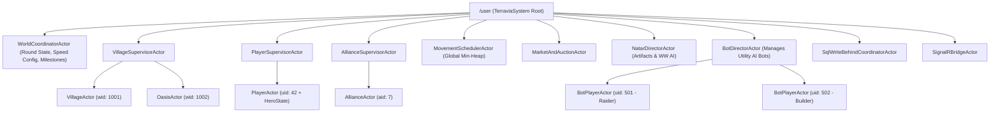
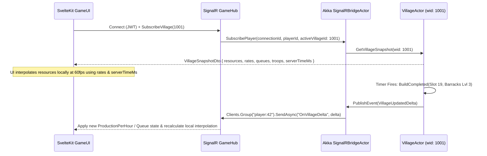
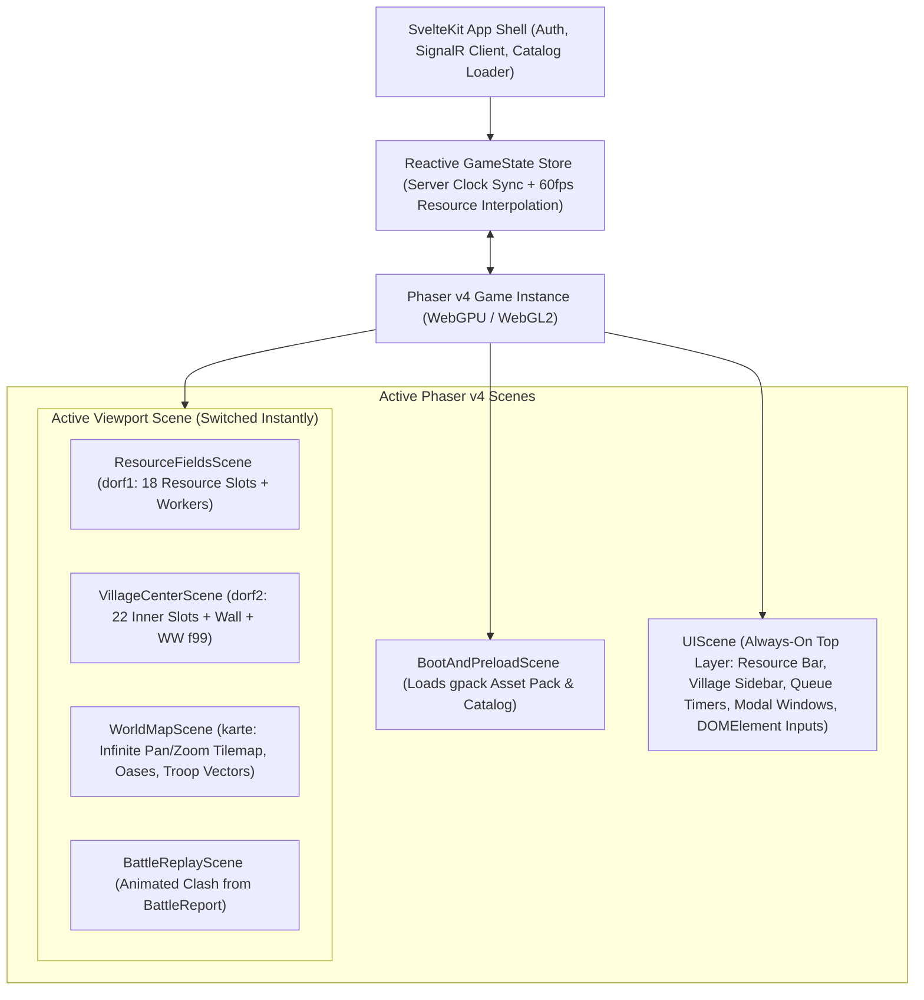

# Terravia Renatus: Architecture Blueprint & TravianZ v11 Feature Extraction

> [!IMPORTANT]
> **Shared Design Alignment Summary (Questions 1–15)**
> - **World Topology**: **Single-World Per Deployment** — One isolated container/process + one dedicated SQL Server database per game round (~500–5,000 players + bots). No `WorldId` tenant key overhead; trivial round resets and container archival.
> - **Repository Layout**: Self-contained `server/` (`server/Terravia.sln`, `server/src/` for C# projects [`Terravia.Domain`, `Terravia.Actors`, `Terravia.BotAI`, `Terravia.Infrastructure`, `Terravia.WebAPI`], and `server/tests/` for test projects, with Akka.NET hosted in-process inside `Terravia.WebAPI` via `Akka.Hosting`) and root-level `client/` monorepo (`apps/game-ui`, `apps/admin-ui`, `packages/game-contracts`, `packages/shared-ui`).
> - **Actor State, Timing & Durability**: Stateful In-Memory Domain Actors with lazy timestamp-delta resource math, millisecond-precision Akka timers (`DateTimeOffset` ms + FIFO `MovementId` tie-breaker), immediate SQL flush on critical events (Gold/Battle/Movement), and `<250ms` command-triggered micro-batch TVP flushes + unified `GameAuditLogs`.
> - **Database & Provisioning**: Modernized SQL Server schema (**EF Core** for migrations/auth/admin CRUD; **Dapper + TVPs** for actor hydration, micro-batch write-behind, map viewports, and rankings) + procedural C# `WorldGenerator` (`SqlBulkCopy` in `<3s` for `400x400` maps, triggerable via env auto-seed or `admin-ui` Reset Wizard).
> - **Auth, Sitters & Balance Catalogs**: Scoped JWTs with Sitter delegation claims (`{ sub: ownerId, act: sitterId, perms: bitmask }`) for zero false-positive MAD flags, and compiled read-only memory catalogs hydrated from versioned JSON/DB exposed via hash-cached `GET /api/game/catalog`.
> - **Bot-End**: Dual-mode C# 10 **Utility AI** running by default as in-process `BotPlayerActor`s via `IGameCommandGateway` (plus optional SignalR/HTTP load-test mode) with Raider, Builder, and Defender personalities and circadian activity schedules.
> - **Frontend Stack**: **Full-Canvas Phaser v4** in `client/apps/game-ui` (parallel `UIScene` for HUD/resource bars/popups over `ResourceFieldsScene`, `VillageCenterScene`, `WorldMapScene`, and `BattleReplayScene`, using Phaser scale-synced `DOMElement` for native text inputs/clipboard) + **Tailwind CSS v4 + `shadcn-svelte` (Bits UI) + ECharts** in `client/apps/admin-ui`.

---

## Part I: Architecture & Best Practices for Terravia Renatus

### 1. Architectural Principles: Pragmatic DDD & Performance-First S.O.L.I.D

Classic browser RTS games fail at scale when every page view or 1-second tick executes database `SELECT`/`UPDATE` queries across villages, troop queues, and movements (the root bottleneck in legacy [Village.php](file:///d:/Projects/TravianZ/GameEngine/Village.php) and [Automation.php](file:///d:/Projects/TravianZ/GameEngine/Automation.php)).

To balance **S.O.L.I.D + DDD** with **Performance-First** execution:

1. **Aggregate Root = Actor Boundary**: In DDD, an Aggregate Root enforces invariants and serializes state mutations. In Akka.NET, each `VillageActor`, `PlayerActor`, `AllianceActor`, and `MarketActor` **is** the in-memory Aggregate Root. Single-threaded message processing inside each actor eliminates database row-locking and race conditions (`TOCTOU`) by design.
2. **Zero-Allocation Hot Paths**: Inside `VillageActor` and `BattleEngine`, avoid object-graph bloat. Represent per-village building slots (`40` slots), troop counts (`90` unit types across 9 tribes), and smithy upgrades as contiguous `int[]` or `InlineArray` / `Span<int>` structures in RAM rather than 90 separate entity objects.
3. **Pure Static Domain Services for Math & Combat**: Keep combat resolution (ported from [`Battle`](file:///d:/Projects/TravianZ/GameEngine/Battle.php#L24-L2064)), production formulas ([`Village::getProdFor`](file:///d:/Projects/TravianZ/GameEngine/Village.php#L73-L78)), and prerequisite tables ([`Building::BUILD_REQUIREMENTS`](file:///d:/Projects/TravianZ/GameEngine/Building.php#L85-L130)) as **stateless, deterministic C# structs/classes** injected via interfaces (`IBattleSimulator`, `IBuildingRuleCatalog`). This obeys **Single Responsibility (SRP)** and **Open/Closed Principle (OCP)** while enabling 100,000+ combat simulations per second in unit tests and Utility AI evaluations.
4. **Lazy Evaluation Over Polling Loops**: Never run a 1-second loop over 20,000 villages to add resources. Store `{ BaseAmount, ProductionPerHour, StorageCap, LastCalculatedAtMs }` in `VillageActor`. Current resources at any instant $t$ are calculated in $O(1)$ time:
   $$\text{Resource}(t) = \min\left(\text{StorageCap}, \text{BaseAmount} + \text{ProductionPerHour} \times \frac{t - \text{LastCalculatedAtMs}}{3,600,000}\right)$$
   You only mutate `BaseAmount` and `LastCalculatedAtMs` when a command deducts/adds resources or a building/oasis/hero bonus changes `ProductionPerHour`.

---

### 2. Solution Structure (`server/src` + `server/tests` & `client/` Root Layout)

```text
terravia-renatus/
├── docs/
│   └── terravia_renatus_architecture_and_features.md
├── server/
│   ├── Terravia.sln
│   ├── src/
│   │   ├── Terravia.Domain/          # Pure C# 10 Aggregates, ValueObjects, Commands/DTOs, IGameCommandGateway, Frozen Catalogs, Battle Math
│   │   ├── Terravia.Actors/          # Akka.NET Actor System, Hierarchy, Timers, Sitter Pipeline, <250ms Micro-Batch Flush Coordinator
│   │   ├── Terravia.BotAI/           # C# 10 Utility AI Engine, Considerations, Response Curves, Personalities
│   │   ├── Terravia.Infrastructure/  # SQL Server: EF Core DbContext, Dapper TVP Repos, SqlBulkCopy WorldGenerator
│   │   └── Terravia.WebAPI/          # ASP.NET Core Web API, Akka.Hosting IHostedService, SignalR Hubs (GameHub, AdminHub), JWT
│   └── tests/
│       ├── Terravia.Domain.Tests/    # Property-based & equivalence tests vs TravianZ formulas
│       ├── Terravia.Actors.Tests/    # Akka.TestKit deterministic timer & movement tests
│       └── Terravia.BotAI.Tests/     # Utility AI decision scoring benchmarks
└── client/
    ├── package.json                  # pnpm / Vite monorepo root
    ├── packages/
    │   ├── game-contracts/           # Shared TypeScript DTOs, SignalR schemas, Catalog types, 60fps interpolation math
    │   └── shared-ui/                # Shared utilities, auth/token stores, SignalR client manager
    └── apps/
        ├── game-ui/                  # SvelteKit (SPA shell) + Phaser v4 Full-Canvas Game Client (UIScene + World Scenes)
        └── admin-ui/                 # SvelteKit + Tailwind CSS v4 + shadcn-svelte (Bits UI) + ECharts Live-Ops Portal
```

---

### 3. Backend Architecture (Akka.NET, C# 10, SQL Server, SignalR)

#### 3.1 Akka.NET Single-World Actor Hierarchy

Because each deployment hosts a single dedicated game world (round), the `ActorSystem` (`TerraviaSystem`) is 100% dedicated to that round with flat, low-latency actor paths and zero multi-tenant routing overhead:



#### 3.2 Key Actor Responsibilities & Lifecycle

| Actor | State Held in RAM | Timers Scheduled (`ITimerScheduler`) | Passivation / Lifecycle |
| :--- | :--- | :--- | :--- |
| **`VillageActor`** | Resource balances & rates, 40 building slots + WW (`f99`), active build/demolition queues, garrisoned & owned troops, smithy tech levels, active celebrations/festivals, hospital wounded queue, starvation timestamp. | Exact timer for next `BuildCompleted`, `TrainingBatchCompleted`, `ResearchCompleted`, `CelebrationEnded`, `StarvationTick`. | Passivates after 30m of player inactivity **only if** no timers are pending; wakes automatically on incoming command or movement arrival. |
| **`PlayerActor`** | Profile, Gold/Silver balance, Plus/GoldClub expirations, Hero state + equipped `HeroItems`, active `HeroAdventure` list, Sitter permissions, Push-Protection rolling counters. | `HeroRegenTick`, `PlusBonusExpired`, `VacationModeEnded`. | Active while player (or Sitter/Bot) is online or Hero is on mission. |
| **`MovementSchedulerActor`** | Priority Queue (Min-Heap sorted by `(ArrivalTimeMs, MovementId)`) of all in-flight troop and merchant movements across the game world. | Single high-precision timer always set to the **earliest** `ArrivalTimeMs` in the heap. | Singleton per server. On wakeup, pops all movements where `ArrivalTimeMs <= NowMs` in strict FIFO order and dispatches `ResolveArrivalCommand` to target `VillageActor`/`OasisActor`. |
| **`AllianceActor`** | Member roster & ranks/permissions, diplomacy treaties, T4 Alliance Bonus pools & levels (`Recruitment`, `Philosophy`, `Metallurgy`, `Commerce`). | `AllianceBonusUpgradeCompleted`. | One actor per active Alliance. |
| **`BotPlayerActor`** | Bot personality profile, blackboard memory (known farm targets, threat history, build plan), circadian schedule. | Staggered `EvaluateUtilityTick` (e.g., every 15–90 seconds with random jitter, paused during bot "sleep" hours). | Managed by `BotDirectorActor`; throttled automatically if server CPU exceeds threshold. |
| **`SqlWriteBehindCoordinatorActor`** | Dirty-entity buffer (`Channel<IDirtyStateSnapshot>`). | Every `250ms` (or when buffer hits `500` items), flushes dirty states to SQL Server via Dapper Table-Valued Parameters (TVPs). | Singleton with graceful shutdown flush guarantee (`CoordinatedShutdown`). |

#### 3.3 Deterministic Movement & Combat Protocol (Zero Race Conditions)

In legacy [`AutomationTroopMovements.php`](file:///d:/Projects/TravianZ/GameEngine/Automation/AutomationTroopMovements.php), concurrent movements arriving at the same village could race with training or building completions. In **Terravia Renatus**:
1. When `VillageActor(A)` sends an attack/reinforcement to `VillageActor(B)`, `VillageActor(A)` validates & deducts the troops in RAM, persists the new `Movement` row, and sends `ScheduleMovement(movement)` to `MovementSchedulerActor`.
2. `VillageActor(B)` receives an `IncomingMovementNotification` (with masked troop counts unless revealed by Rally Point/Artifact Sight rules) and pushes a real-time alert to Player B via SignalR.
3. At `ArrivalTimeMs` (millisecond precision, ties broken deterministically by `MovementId`), `MovementSchedulerActor` sends `ProcessArrivingMovement(movement)` to `VillageActor(B)`.
4. **Inside `VillageActor(B)`**: Before resolving the arrival, `VillageActor(B)` synchronously advances its own lazy resource/training/building state up to `movement.ArrivalTimeMs`. This guarantees that any troop trained or wall built at `ArrivalTimeMs - 1ms` participates in the battle, and anything finishing at `ArrivalTimeMs + 1ms` does not!
5. `VillageActor(B)` invokes the pure `BattleEngine.Resolve(...)`, updates garrison/building/loyalty state, emits `BattleReportCreated`, schedules survivor return via `MovementSchedulerActor`, and triggers an **immediate persistence flush** for the battle outcome.

---

#### 3.4 SQL Server Hybrid Strategy (EF Core + Dapper) & Modernized Schema

Instead of legacy TravianZ's 90-column horizontal tables ([`%PREFIX%units`](file:///d:/Projects/TravianZ/var/db/struct.sql#L1970-L2066), [`%PREFIX%fdata`](file:///d:/Projects/TravianZ/var/db/struct.sql#L893-L982), [`%PREFIX%tdata`](file:///d:/Projects/TravianZ/var/db/struct.sql#L1830-L1914)), we use a clean, single-world SQL Server schema with compact indexes:

##### Schema Design Highlights
- **`ServerConfig`**: Single-row / key-value configuration table for the round (`ServerName, Speed, TroopSpeed, EvasionSpeed, MapRadius, StartDateUtc, Status, IsMaintenanceMode, AllianceBonusesEnabled`).
- **`Players`** (replaces `users` + `activate`): `(PlayerId, Username, PasswordHash, Email, TribeId, AccessRole, Gold, Silver, CulturePoints, PlusExpiresAt, GoldClubExpiresAt, BonusExpiresJson, Sitter1Id, Sitter1PermMask, Sitter2Id, Sitter2PermMask, AllianceId, ProtectionExpiresAt, VacationModeUntil, IsBot, BotPersonalityId)`.
- **`MapTiles`** (replaces `wdata` + `croppers`): `(TileId, X, Y, FieldTopologyId, OasisTypeId, BestOasisCropBonus, OccupiedByVillageId)` with a composite spatial index `IX_MapTiles_XY (X, Y) INCLUDE (FieldTopologyId, OasisTypeId, OccupiedByVillageId)`.
- **`Villages`** (replaces `vdata` + `fdata` + `units` + `tdata` + `abdata`):
  - Scalar columns for indexed/queried fields: `(VillageId, TileId, OwnerPlayerId, Name, IsCapital, IsNatar, Population, CulturePointsPerDay, Loyalty, Wood, Clay, Iron, Crop, WarehouseCap, GranaryCap, LastUpdatedMs)`.
  - **Normalized high-density child tables**:
    - `VillageBuildings`: `(VillageId, SlotId [1..40, 99], BuildingTypeId [1..50], Level)` — indexed by `PK (VillageId, SlotId)`.
    - `VillageTroopStacks`: Replaces `units`, `enforcement`, `prisoners`, and `hospital` with a single unified table: `(StackId, LocationVillageId, OwnerVillageId, StackType [Home/Reinforcement/Trapped/Hospital], UnitTypeId [1..90], Count)`! An army of 3 unit types takes 3 compact rows instead of a 95-column row of zeros.
    - `VillageQueueItems`: Unified table for Building (`bdata`), Demolition (`demolition`), Training (`training`), Healing (`healing`), and Research (`research`) queues: `(QueueItemId, VillageId, QueueCategory, TargetId, TargetSlotOrLevel, Quantity, EachDurationMs, StartedAtMs, FinishesAtMs, IsMasterBuilder)`.

##### EF Core vs. Dapper Division Matrix

| Workload | Tool | Why / Best Practice |
| :--- | :--- | :--- |
| **Schema Migrations, Seeding & Rule Catalogs** | **EF Core 6/7+** | Code-first migrations, world installation/reset, strongly-typed seeding of Tribes, 50 Buildings, 90 Units, Hero Items, and Quests. |
| **Auth, Account Settings, Admin CRUD** | **EF Core** | Low-frequency, high-invariant CRUD where change tracking and navigation properties shine. |
| **Actor State Hydration (`VillageActor` startup)** | **Dapper (`QueryMultipleAsync`)** | Fetches `Village` + `VillageBuildings` + `VillageTroopStacks` + `VillageQueueItems` in a **single round-trip** multi-resultset SQL batch in `< 1.5ms`. |
| **Write-Behind Batch Flushing (`SqlWriteBehindCoordinatorActor`)** | **Dapper + SQL Server TVPs** | Passes a `DataTable` / `SqlDataRecord` Table-Valued Parameter (`@VillageUpdates`, `@StackUpdates`) to a compiled stored procedure `usp_FlushVillageStates`, updating 500 villages in a single ~5ms transaction. |
| **World Map Viewport (`karte`) & Crop Finder** | **Dapper** | Queries `IX_MapTiles_XY` with `X BETWEEN @xMin AND @xMax AND Y BETWEEN @yMin AND @yMax` directly into lightweight `MapTileDto` structs with zero EF tracking overhead. |
| **Leaderboards, MAD & Push-Protection Analytics** | **Dapper** | Executes windowed aggregations (`RANK() OVER (...)`) and 7-day rolling transfer sums directly in SQL Server. |

---

#### 3.5 SignalR Real-Time Architecture



- **SignalR Groups**:
  - `server:global` — Server announcements, World Wonder milestones, Global Chat messages & live poll votes.
  - `alliance:{allianceId}` — Alliance chat, shared battle reports, incoming attack alerts on alliance members, T4 Alliance Bonus progress.
  - `player:{playerId}` — Incoming movement alerts, unread message/report badges, Hero status changes, Gold/Silver updates.
  - `village:{villageId}` — Active village building/training/research completions and resource rate changes (subscribed when player switches active village).

#### 3.6 Crash Durability, Unified Audit Logging & Provisioning
1. **Command-Triggered Micro-Batch Persistence (`< 250ms`)**:
   - Because resource accumulation is a pure function of `(BaseAmount, ProductionPerHour, LastUpdatedMs)`, routine seconds passing require **zero database writes**.
   - Only **explicit commands** (e.g., `StartBuild`, `TrainUnits`, `DonateAllianceBonus`) and **timer completions** (`BuildCompleted`, `TrainingBatchCompleted`) mutate actor state.
   - High-stakes mutations (`SpendGold`, `DispatchTroopMovement`, `ResolveBattle`, `ConquerVillage`, `AuctionBid`) flush synchronously/immediately; routine village mutations and audit entries are micro-batched every `250ms` via Dapper TVPs in `SqlWriteBehindCoordinatorActor`, with `CoordinatedShutdown` flushing any remaining items on container stop.
2. **Unified `GameAuditLogs` Table + OpenTelemetry**:
   - Consolidates legacy TravianZ's 8 fragmented log tables (`build_log`, `tech_log`, `gold_fin_log`, `market_log`, `admin_log`, `login_log`, `illegal_log`, `ali_log`) into a single indexed, partitioned `GameAuditLogs` table: `(LogId, TimestampMs, Category, ActorPlayerId, TargetPlayerId, VillageId, AllianceId, ActionCode, GoldDelta, PayloadJson, IpAddress)`.
   - Structured logs and actor metrics (active actors, mailbox depth, TVP flush latency, bot tick duration) are exported via **Serilog + OpenTelemetry** to `admin-ui`.
3. **Scoped JWT Authentication & Sitter Delegation**:
   - Primary login issues a JWT (`{ sub: playerId, role: Player|Multihunter|Admin }`).
   - Switching to a sitted account issues a short-lived delegated Sitter JWT containing `{ sub: ownerPlayerId, act: sitterPlayerId, perms: sitPermBitmask }`.
   - A central Akka command pipeline validates `perms` (e.g., `SITTER_PERM_RAID`, `SITTER_PERM_ATTACK`, `SITTER_PERM_GOLD`) before routing to `PlayerActor`/`VillageActor` and records both `ActorPlayerId` and `TargetPlayerId` in `mad_session` and `GameAuditLogs` so legal sitting never triggers false-positive multi-account alerts.
4. **Compiled Read-Only Balance Catalogs & `< 3s` Procedural `WorldGenerator`**:
   - Base definitions for the 9 Tribes, 90 Units, 50 Buildings, T4 Hero Items, and Quests live in versioned JSON files hydrated at boot into immutable memory tables (`FrozenDictionary` / readonly arrays) in `Terravia.Domain`, merged with DB overrides (`ServerConfig`, `QuestConfig`), and served to `client/` via hash-cached `GET /api/game/catalog` (`ETag`).
   - `WorldGenerator` procedurally generates up to `400x400` (`641,601` tiles) maps, computes `BestOasisCropBonus` for every 9c/15c cropper, seeds Nature oasis garrisons, NPC accounts (`Nature`, `Natars`, `Taskmaster`, `Multihunter`), and initial Utility AI Bots, streaming everything to SQL Server via `SqlBulkCopy` in `< 3 seconds` (triggered via environment config on first boot or from the `admin-ui` Round Reset Wizard).

---

### 4. Frontend Architecture: `client/apps/game-ui` & `client/apps/admin-ui`

#### 4.1 Technology Split: Full-Canvas Phaser v4 (`game-ui`) vs. Data-Rich Dashboard (`admin-ui`)

| App | Core Rendering & UI Stack | Responsibility |
| :--- | :--- | :--- |
| **`client/apps/game-ui`** | **SvelteKit (`ssr = false` SPA shell) + Vite + Phaser v4 (WebGPU/WebGL2 Full-Canvas)** | Renders the entire gameplay experience inside Phaser v4 scenes (`UIScene` HUD, resource bars, village switcher, modal popups, `ResourceFieldsScene`, `VillageCenterScene`, `WorldMapScene`, `BattleReplayScene`), using Phaser's scale-synced `DOMElement` strictly for `<input>`/`<textarea>` fields so native mobile keyboards, IME, and copy/paste work seamlessly. |
| **`client/apps/admin-ui`** | **SvelteKit + Vite + Tailwind CSS v4 (`@tailwindcss/vite`) + `shadcn-svelte` (Bits UI) + Apache ECharts** | High-density Live-Ops & Moderation portal: Server Setup/Reset Wizard, Multi-Account Detection (MAD) network graphs, 7-day Push-Protection tables, World Map Heatmap, Quest/Catalog Editor, and Live Utility AI Bot Director. |
| **`client/packages/game-contracts`** | **TypeScript Strict** | Shared DTOs, SignalR hub contracts, `GameCatalog` lookup helpers, and deterministic 60fps resource/timer interpolation math used by both Phaser scenes and Admin tools. |

#### 4.2 Phaser v4 Multi-Scene Architecture in `client/apps/game-ui`



1. **`BootAndPreloadScene`**: Fetches `/api/game/catalog` and loads the player's selected graphic pack manifest (`load.pack('gpack', ...)`), supporting both legacy `TravianZ/gpack` sprites and custom **Terravia Renatus** texture atlases.
2. **`UIScene` (Persistent Overlay Scene)**:
   - Renders the top Wood/Clay/Iron/Crop/Upkeep bar (updated every frame from the deterministic interpolation formula), Gold/Silver counters, Hero status portrait, Village list switcher, active Building/Training/Movement countdown widgets, and modal windows (Buildings, Marketplace, Rally Point, Alliance, Reports, Hero Inventory/Auction, Global Chat).
   - Uses Phaser's `this.add.dom(x, y, ...)` inside modal windows for text/number inputs (troop dispatch counts, market offers, chat/IGM messages, coordinate inputs) so players get native OS copy-paste, tab navigation, and mobile keyboards inside the full-canvas UI.
3. **Spatial Viewport Scenes (`ResourceFieldsScene`, `VillageCenterScene`, `WorldMapScene`, `BattleReplayScene`)**:
   - **Camera & Culling**: `WorldMapScene` uses Phaser's `Cameras.Scene2D` for smooth drag-panning and pinch-to-zoom across the `400x400` world, streaming `32x32` tile chunks from `GET /api/game/map` and rendering alliance diplomacy borders, `9c`/`15c` crop-finder badges, and animated marching troop lines.
   - **`BattleReplayScene`**: Turns any deterministic `BattleReport` into an optional animated visual replay showing attacking vs. defending unit stacks, ram/catapult volleys, trap captures, and hero combat effects.

#### 4.3 `client/apps/admin-ui` Capabilities (Tailwind CSS v4 + `shadcn-svelte` + ECharts)
1. **Round Provisioning & Live Config**: Configure round speed multipliers, toggle T4 systems, manage maintenance mode, and trigger the `< 3s` `SqlBulkCopy` Round Reset Wizard.
2. **Anti-Cheat & Moderation Center**:
   - **Multi-Account Detection (MAD) Graph (ECharts Force-Directed Graph)**: Visualizes suspicious account pairs scored by shared IP/subnet, User-Agent hash, login switch windows (`< 15m`), and resource push flows (ported from [`MultiAccount.php`](file:///d:/Projects/TravianZ/GameEngine/MultiAccount.php)).
   - **Push-Protection Dashboard**: 7-day rolling resource transfer balance vs. allowed hours of production with 1-click WW/Artifact exemptions (ported from [`PushProtection.php`](file:///d:/Projects/TravianZ/GameEngine/PushProtection.php)).
3. **World Map Heatmap (ECharts Canvas Heatmap)**: Visual overlay of player density, combat casualties, resource flows, and Natar/Artifact distribution (ported from [`Heatmap.php`](file:///d:/Projects/TravianZ/GameEngine/Heatmap.php)).
4. **Bot AI Live-Ops Director**: Spawn/despawn Utility AI bots, adjust personality ratios, inspect a bot's live Utility AI consideration scores, and monitor OpenTelemetry server/actor health.

---

### 5. Bot-End Architecture (C# 10 + Utility AI)

#### 5.1 Dual-Mode Execution via `IGameCommandGateway`
Bots never mutate database rows or actor fields directly. Every `BotPlayerActor` interacts with the game through `IGameCommandGateway`:
- **In-Process Mode (Default Production)**: `AkkaGameCommandGateway` sends typed command messages (`UpgradeBuildingCommand`, `TrainUnitsCommand`, `SendTroopsCommand`, `CreateMarketOfferCommand`) directly to the target `PlayerActor` / `VillageActor`. Zero HTTP/JSON overhead allows **2,000+ intelligent bots** on a single node using `< 5%` CPU.
- **External Network Mode (Load Testing)**: `SignalRHttpGameCommandGateway` connects over WebSockets/REST using a bot JWT to stress-test the full Kestrel + SignalR + API pipeline.
- **Strict Fog-of-War & Rule Parity**: Bots only know what their `PlayerViewSnapshot` exposes (their own villages, public map tiles, alliance shared reports, and their own scout/battle reports).

#### 5.2 Utility AI Architecture in C# 10

Utility AI evaluates a set of candidate `BotAction`s on each decision tick and scores each action $a$ in $[0.0, 1.0]$ by multiplying normalized **Considerations** passed through parameterized **Response Curves** (Linear, Polynomial, Logistic, Logit), compensated by the geometric mean modification factor so adding more considerations doesn't artificially depress scores:

$$\text{Score}(a) = \text{Weight}_{\text{personality}}(a) \times \left(\prod_{i=1}^{n} c_i\right)^{\text{ModificationFactor}}$$

```mermaid
flowchart LR
    Percept["Bot Perception Snapshot\n(Resources, Queues, Threats, Map Targets)"]
    
    subgraph Scorers["Utility AI Action Scorers"]
        S1["UpgradeResourceField\n(Crop Deficit / RoI Curve)"]
        S2["UpgradeInfrastructure\n(Warehouse Cap / Prerequisite Curve)"]
        S3["TrainMilitary\n(Off/Def Ratio & Threat Curve)"]
        S4["SendFarmRaid\n(Expected Loot / Distance / Risk Curve)"]
        S5["DefendOrEvade\n(Incoming Attack Power vs Garrison)"]
        S6["FoundOrConquerVillage\n(CP Ready & Settlers/Chief Ready)"]
    end

    Percept --> Scorers
    Scorers --> Selector["Weighted Top-K Selector + Human Delay Jitter"]
    Selector --> Gateway["IGameCommandGateway"]
```



#### 5.3 Bot Archetypes (Personalities) & Human-Like Realism
1. **The Raider (`Teuton / Hun` bias)**: High weight on `SendFarmRaid` and `TrainOffense`; builds Barracks/Stable early, maintains active farm lists of nearby oases and inactive villages, uses Gold Club evasion or manual troop dodging when attacked by superior forces.
2. **The Simmer / Economy Builder (`Egyptian / Gaul` bias)**: Prioritizes resource fields, bonus buildings (Sawmill, Bakery, Waterworks), Crannies/Trappers, Town Hall celebrations, and rapid Culture Point expansion to settle 9c/15c croppers.
3. **The Anvil / Defender (`Roman / Spartan / Gaul` bias)**: Trains high infantry/cavalry defense ratios, upgrades Walls & Hospital, responds to `AllianceIncomingAttackAlert` by sending timed reinforcements to allied villages.
4. **Circadian Activity & Anti-Robotic Jitter**:
   - Each bot is assigned a simulated timezone and sleep window (e.g., `01:00–07:30` local time) where it does not issue routine actions.
   - Incoming attack alerts trigger a human reaction delay (e.g., `30s–180s` log-normal distribution) before the bot evaluates `DefendOrEvade`.

---

## Part II: TravianZ v11 Codebase Analysis & Extracted Completed Features

We analyzed the entire [TravianZ](file:///d:/Projects/TravianZ/README.md) v11 codebase (`342` PHP files, `14` Database traits, `11` Automation traits, `53` SQL tables in [struct.sql](file:///d:/Projects/TravianZ/var/db/struct.sql)). Below is the complete inventory of completed game systems to port into `Terravia.Domain`.

### 1. Core Tribes, Units & Buildings Catalog

| Domain Area | TravianZ Source Files | Completed Features & Mechanics Extracted |
| :--- | :--- | :--- |
| **9 Tribes (7 Playable + 2 NPC)** | [unitdata.php](file:///d:/Projects/TravianZ/GameEngine/Data/unitdata.php), [Building.php](file:///d:/Projects/TravianZ/GameEngine/Building.php) | **Playable**: `1` Romans (`u1..u10`), `2` Teutons (`u11..u20`), `3` Gauls (`u21..u30`), `6` Huns (`u51..u60`), `7` Egyptians (`u61..u70`), `8` Spartans (`u71..u80`), `9` Vikings (`u81..u90`).<br>**NPC**: `4` Nature/Oasis animals (`u31..u40`), `5` Natars (`u41..u50`).<br>Formula: Unit IDs for tribe $T$ are $(T-1)\times 10 + 1 \dots (T-1)\times 10 + 10$. |
| **50 Building Types (`gid 1..50, 99`)** | [buidata.php](file:///d:/Projects/TravianZ/GameEngine/Data/buidata.php), [Building.php](file:///d:/Projects/TravianZ/GameEngine/Building.php#L85-L130) | **Resources (`1..4`)**: Woodcutter, Clay Pit, Iron Mine, Cropland.<br>**Bonus (`5..9, 45`)**: Sawmill, Brickyard, Iron Foundry, Grain Mill, Bakery, **Waterworks (`gid 45`, Egyptians)**.<br>**Storage (`10, 11, 38, 39`)**: Warehouse, Granary, Great Warehouse, Great Granary.<br>**Military (`12..14, 16, 19..22, 29, 30, 36, 37, 41, 46, 48, 49`)**: Blacksmith/Armoury/Smithy (`12, 13`), Tournament Square (`14`), Rally Point (`16`), Barracks (`19`), Stable (`20`), Workshop (`21`), Academy (`22`), Great Barracks (`29`), Great Stable (`30`), **Trapper (`36`, Gauls)**, Hero's Mansion (`37`), **Horse Drinking Trough (`41`, Romans)**, **Hospital (`46`)**, **Big Hospital (`48`, Spartans/Vikings)**, **Great Workshop (`49`)**.<br>**Walls (`31..33, 42, 43, 47, 50`)**: City Wall (Romans), Earth Wall (Teutons), Palisade (Gauls), Stone Wall (`42`, Egyptians), Makeshift Wall (`43`, Huns), Defensive Wall (`47`, Spartans), Barricade (`50`, Vikings).<br>**Civic/Expansion (`15, 17, 18, 23..28, 34, 35, 40, 44`)**: Main Building (`15`), Marketplace (`17`), Embassy (`18`), Cranny (`23`), Town Hall (`24`), Residence (`25`), Palace (`26`), Treasury (`27`), Trade Office (`28`), Stonemason's Lodge (`34`), **Brewery (`35`, Teutons)**, World Wonder (`40`/`f99`), **Command Center (`44`, Huns — 3 expansion slots)**. |
| **Build Queue & Master Builder** | [Building.php](file:///d:/Projects/TravianZ/GameEngine/Building.php#L141-L164), [AutomationBuildQueue.php](file:///d:/Projects/TravianZ/GameEngine/Automation/AutomationBuildQueue.php) | Roman simultaneous resource + inner building construction; Travian Plus extra queue slot (`loopcon`); Master Builder queued slots (`master = 1`, deducts Gold + resources upon slot activation); Main Building (`gid 15` >= 10) level-by-level demolition (`demolition` table) + 10-Gold instant demolition. |

### 2. Economy, Villages, Oases & Starvation

| Domain Area | TravianZ Source Files | Completed Features & Mechanics Extracted |
| :--- | :--- | :--- |
| **Village Resource Engine** | [Village.php](file:///d:/Projects/TravianZ/GameEngine/Village.php#L73-L350), [resdata.php](file:///d:/Projects/TravianZ/GameEngine/Data/resdata.php) | 12 village field topologies (`f1..f18` distributions, including `9c` `fieldtype=1` and `15c` `fieldtype=6`). Production combines base field output + bonus buildings (`5%`–`25%` each) + annexed Oasis bonuses (`25%`/`50%` scaled by Hero Mansion and Egyptian Waterworks `gid 45`) + Hero resource production + Plus `+25%` resource bonuses (`b1..b4`), minus troop crop upkeep (reduced by Roman Horse Drinking Trough `gid 41` and Diet Artifacts). |
| **Oases & Annexation** | [AutomationVillageUpkeep.php](file:///d:/Projects/TravianZ/GameEngine/Automation/AutomationVillageUpkeep.php) | Unoccupied oases spawn/regenerate Nature troops (`u31..u40`); players can raid oases, capture animals using Hero Cages, or annex up to 3 oases per village via Hero's Mansion (`gid 37` at levels `10, 15, 20`) within a 7x7 radius when oasis loyalty reaches `0%`. |
| **Starvation System** | [AutomationStarvation.php](file:///d:/Projects/TravianZ/GameEngine/Automation/AutomationStarvation.php) | When village `crop < 0` and net crop production is negative, troops starve one by one (`crop` refilled by the starved unit's crop training cost) in priority order: foreign reinforcements first, then home troops from largest stack. |
| **Celebrations & Mead Festival** | [celebration.php](file:///d:/Projects/TravianZ/celebration.php), [festival.php](file:///d:/Projects/TravianZ/festival.php), [cel.php](file:///d:/Projects/TravianZ/GameEngine/Data/cel.php) | Town Hall (`gid 24`) Small Celebration (up to 500 CP) and Great Celebration (up to 2000 CP + `+5%` chief loyalty reduction bonus in attacks, `-5%` enemy chief effectiveness). Teuton Brewery (`gid 35`) hosts 72-hour **Mead Festival** (`+1%` attack power per Brewery level, but Enemy/Own chiefs have halved persuasion and catapults can only hit random targets). |

### 3. Combat, Movements, Traps, Hospital & Conquest

| Domain Area | TravianZ Source Files | Completed Features & Mechanics Extracted |
| :--- | :--- | :--- |
| **Combat Resolution & War Simulator** | [Battle.php](file:///d:/Projects/TravianZ/GameEngine/Battle.php), [AutomationBattleResolution.php](file:///d:/Projects/TravianZ/GameEngine/Automation/AutomationBattleResolution.php), [warsim.php](file:///d:/Projects/TravianZ/warsim.php) | **Attack Types**: `1` Scout/Spy (Resources & Troops or Defenses & Wall), `2` Reinforcement, `3` Normal Attack, `4` Raid, `5` Settler Founding.<br>**Combat Math**: Calculates Infantry vs Cavalry attack ratios, applies Smithy upgrades, Wall defense multiplier & flat defense bonus, Residence/Palace/Command Center defense, Morale bonus (population ratio), Brewery bonus, Hero off/def % bonus + T4 Hero Item bonuses ([HeroBattleBonus.php](file:///d:/Projects/TravianZ/GameEngine/HeroBattleBonus.php)), and T4 Alliance Metallurgy bonus.<br>**Casualty Curve**: Classic $\sigma(x)$ formula (`pow(x, 1.5)` for $x \le 1$, `2 - pow(x, -1.5)` for $x > 1$) with Immensity factor $1.5$ for large battles (`> 1000` units). |
| **Rams, Catapults & Chiefs/Senators** | [AutomationBattleResolution.php](file:///d:/Projects/TravianZ/GameEngine/Automation/AutomationBattleResolution.php) | **Rams**: Early-phase wall reduction + final wall demolition.<br>**Catapults**: Single or dual target (`ctar1`, `ctar2` at Rally Point Lvl 20 with `>= 20` catapults); modified by Stonemason's Lodge (`gid 34`), Architect Artifacts (`4x/3x/5x`), and Confusion Artifacts / Brewery random targeting.<br>**Conquest (Loyalty)**: Senators/Chiefs/Chieftains/Logades/Nomarchs reduce village loyalty (`vdata.loyalty`) when defender has no Residence/Palace/Command Center and attacker has enough Culture Points; captures village at `0%` loyalty. |
| **Gaul Trapper & Prisoners** | [AutomationBattleResolution.php](file:///d:/Projects/TravianZ/GameEngine/Automation/AutomationBattleResolution.php) | Trapper (`gid 36`, up to 400 traps per level20 building) captures attacking troops (`prisoners` table / `u99`) before combat. Normal attacks that win release trapped troops (`25%` trap repair / casualties); owner or attacker can release/dissolve prisoners. |
| **Hospital & Healing Queue** | [AutomationTraining.php](file:///d:/Projects/TravianZ/GameEngine/Automation/AutomationTraining.php), [struct.sql](file:///d:/Projects/TravianZ/var/db/struct.sql#L2408-L2513) | Hospital (`gid 46`) and Big Hospital (`gid 48`, Spartans/Vikings) save a percentage of battle casualties as wounded troops (`hospital` table), which can be healed back into active service via the `healing` queue at reduced cost/time. |
| **Troop Evasion & Farm Lists** | [Units.php](file:///d:/Projects/TravianZ/GameEngine/Units.php), [AutomationTroopMovements.php](file:///d:/Projects/TravianZ/GameEngine/Automation/AutomationTroopMovements.php) | Capital troop auto-evasion when attacked (troops walk out for 180s at `EVASIONSPEED` and return); Gold Club **Farm Lists** (`farmlist` + `raidlist` tables) for batch raid dispatching. |

### 4. T4 Hero System (Items, Adventures & Silver Auction House)

| Domain Area | TravianZ Source Files | Completed Features & Mechanics Extracted |
| :--- | :--- | :--- |
| **Hero Stats & Progression** | [HeroBattleBonus.php](file:///d:/Projects/TravianZ/GameEngine/HeroBattleBonus.php), [AutomationHero.php](file:///d:/Projects/TravianZ/GameEngine/Automation/AutomationHero.php) | Hero attributes: Fighting Strength (`attack`), Off-Bonus (`attackbonus`, `0.2%`/pt), Def-Bonus (`defencebonus`, `0.2%`/pt), Regeneration (`regeneration`), and **T4 Resource Production (`resources`, all-four or single resource mode `res_type`)**. Revival in any village with Hero's Mansion. |
| **Equippable Items & Consumables** | [HeroItems.php](file:///d:/Projects/TravianZ/GameEngine/HeroItems.php), [hero_items.php](file:///d:/Projects/TravianZ/GameEngine/Data/hero_items.php) | **Slots**: Helmet (XP / CP / Cavalry / Infantry speed), Right Hand (Tribe-specific unit weapons, Tier 1–3), Left Hand (Shields, Maps for return speed, Pennants/Standards for troop speed between own/allied villages, Thief Pouches for cranny plundering, Natar Horns), Body Armor (Damage reduction / Regen / Fighting strength), Boots (Speed after >20 tiles / Regen), Horse (Base speed `14/17/20`), Consumables (Ointments, Scrolls, Buckets of Water, Tablets of Law, Artworks, Bandages `25%/33%`, Cages). |
| **Hero Adventures** | [HeroAdventure.php](file:///d:/Projects/TravianZ/GameEngine/HeroAdventure.php) | Periodic adventure spawning around player villages (`normal` vs `hard` difficulty), expiration timers, hero travel movement, damage/XP calculation, and loot rolls (Equipment, Consumables, Resources, Silver, Stray Troops). |
| **Silver Auction House** | [HeroAuction.php](file:///d:/Projects/TravianZ/GameEngine/HeroAuction.php) | Player-to-player item auctions (`auction` table) using **Silver** currency with proxy/max-bid auto-bidding (`bid_max`), bid escrow, anti-sniping extensions, and Gold-to-Silver / Silver-to-Gold exchange. |

### 5. Marketplace, Alliances, T4 Alliance Bonuses & Social

| Domain Area | TravianZ Source Files | Completed Features & Mechanics Extracted |
| :--- | :--- | :--- |
| **Marketplace, Trade Routes & NPC** | [Market.php](file:///d:/Projects/TravianZ/GameEngine/Market.php), [AutomationMarket.php](file:///d:/Projects/TravianZ/GameEngine/Automation/AutomationMarket.php) | Direct resource sending (`send` + `movement`), Open Market Offers (`market` table with alliance-only filter and max travel time), Plus **Trade Routes** (`route` table for recurring scheduled deliveries), and 3-Gold **NPC Merchant** instant 1:1 resource redistribution. |
| **Alliances, Diplomacy & Forums** | [Alliance.php](file:///d:/Projects/TravianZ/GameEngine/Alliance.php), [DatabaseForumQueries.php](file:///d:/Projects/TravianZ/GameEngine/Database/DatabaseForumQueries.php) | Embassy capacity (`3` members per Embassy level up to 60); granular member permissions (`opt1..opt8`: assign ranks, kick, change description, diplomacy, invite, forum mod, mass IGM); Confederacy / NAP / War diplomacy (`diplomacy` table); internal/public/allied Forums with Polls (`forum_survey`). |
| **T4 Alliance Bonuses** | [AllianceBonus.php](file:///d:/Projects/TravianZ/GameEngine/AllianceBonus.php) | 4 Alliance-wide upgradable bonuses (Levels 1–5) unlocked via daily member resource donations (`alliance_bonus`, `alliance_donation`):<br>1. **Recruitment** (faster troop training)<br>2. **Philosophy** (higher Culture Point output)<br>3. **Metallurgy** (higher troop offense & defense)<br>4. **Commerce** (higher merchant capacity) |
| **Messages, Reports & Global Chat** | [Message.php](file:///d:/Projects/TravianZ/GameEngine/Message.php), [Chat.php](file:///d:/Projects/TravianZ/GameEngine/Chat.php), [DatabaseGlobalChatQueries.php](file:///d:/Projects/TravianZ/GameEngine/Database/DatabaseGlobalChatQueries.php) | Private messages (`mdata`) with BBCode, archive, notes, and friend list; categorized Battle/Trade/Reinforcement/Scout Reports (`ndata`) with attack filters; Alliance Chat (`chat`) + **Global Server Chat (`chat_global`)** featuring live Polls (`chat_global_polls`), 1-click Battle Report sharing (`chat_global_shared_reports`), and Moderator Mutes (`chat_mutes`). |

### 6. Endgame (Natars, Artifacts, World Wonders), Quests & Admin

| Domain Area | TravianZ Source Files | Completed Features & Mechanics Extracted |
| :--- | :--- | :--- |
| **Artifacts & World Wonders** | [Artifacts.php](file:///d:/Projects/TravianZ/GameEngine/Artifacts.php), [AutomationNatarsWW.php](file:///d:/Projects/TravianZ/GameEngine/Automation/AutomationNatarsWW.php), [AutomationNatarsWWBuild.php](file:///d:/Projects/TravianZ/GameEngine/Automation/AutomationNatarsWWBuild.php) | Scheduled spawning of Natar Capital, WW villages, normal Artifacts (Small = village scope, Large = account scope, Unique = strongest account scope; Treasury Lvl 10 for Small, Lvl 20 for Large/Unique, 24h activation delay): **Architect's Secret, Boots of Titan, Hawk's Eyes, Diet Control, Academic Advancement, Great Storage Blueprint, Rivals' Confusion, Artifact of the Fool (randomizes every 24h)**, plus **13 WW Building Plans** (`type 11`: 1 plan required for WW Lvl 1–49, 2nd plan in alliance required for Lvl 50–100). Automated Natar attacks on WW levels (`5, 10, ..., 95, 96, 97, 98, 99`) and automatic Natar WW construction up to Lvl 100. |
| **Quests, Rankings, Medals & Milestones** | [QuestConfig.php](file:///d:/Projects/TravianZ/GameEngine/QuestConfig.php), [Ranking.php](file:///d:/Projects/TravianZ/GameEngine/Ranking.php), [AutomationMedals.php](file:///d:/Projects/TravianZ/GameEngine/Automation/AutomationMedals.php) | Taskmaster tutorial quests (`standard` & `extended` variants, configurable in `quest_config`); Top-10 weekly medals (Climbers, Attackers, Defenders, Robbers + Combined) for players and alliances; **Special Medals** (Artifact Owner, WW Owner, WW Winner, Hero Lvl 100, Great Warehouse/Granary, Wall Master); **Server Milestones** (`milestones` table: race-condition-free "First player to..."); **Graphical Statistics** (`player_statistics_history`). |
| **Account Protection, Vacation & Sitters** | [Session.php](file:///d:/Projects/TravianZ/GameEngine/Session.php), [Profile.php](file:///d:/Projects/TravianZ/GameEngine/Profile.php) | Beginner's Protection (`protect` timer); **Vacation Mode** (validates 9 conditions: no outgoing/incoming troops, no active queues, no WW/Artifacts, etc.); **2 Sitters** per account with granular bitmask permissions (`sit1_perm`, `sit2_perm`: raid, attack, reinforce, send resources, buy/spend Gold, chat/IGM); 72-hour account deletion countdown. |
| **Gold Shop & Admin Security Suite** | [GoldShop.php](file:///d:/Projects/TravianZ/GameEngine/GoldShop.php), [MultiAccount.php](file:///d:/Projects/TravianZ/GameEngine/MultiAccount.php), [PushProtection.php](file:///d:/Projects/TravianZ/GameEngine/PushProtection.php), [RegBlock.php](file:///d:/Projects/TravianZ/GameEngine/RegBlock.php), [Heatmap.php](file:///d:/Projects/TravianZ/GameEngine/Heatmap.php) | Gold packages & Promo/Voucher codes (`gold_promo`), Gold financial audit ledger (`gold_fin_log`), Multi-Account Detection (`mad_session`), 7-day Push Protection (`resource_transfer_log`, `push_override`), Registration Blocklist (`reg_block`), IP & Account Ban Manager (`banlist`, `banlist_ip`), World Heatmap, Maintenance Mode (`maintenance`), and Runtime Debug Logger (`debug_log`). |

---

## Part III: 4-Phase Implementation Roadmap

| Phase | Milestone Focus | Key Deliverables |
| :--- | :--- | :--- |
| **Phase 1: Core Engine, 3 Classic Tribes & Utility AI Bots** | Playable Vertical Slice | • Solution scaffolding (`server/src/Terravia.Domain`, `Actors`, `Infrastructure`, `BotAI`, `WebAPI` + `client/apps/game-ui`, `admin-ui`).<br>• SQL Server schema (EF Core migrations + Dapper TVP batch flush).<br>• `WorldCoordinatorActor`, `VillageActor`, `PlayerActor`, `MovementSchedulerActor`.<br>• Romans, Teutons, Gauls (`u1..u30`), core buildings (`gid 1..41`), Resource/Build/Training/Research queues, Battle Engine & Conquest, Marketplace.<br>• `BotPlayerActor` + Utility AI Personalities (Raider, Builder, Defender).<br>• SvelteKit + Phaser v4 Full-Canvas `game-ui` (`UIScene`, `ResourceFieldsScene`, `VillageCenterScene`, `WorldMapScene`, Rally Point, Reports). |
| **Phase 2: All 7 Playable Tribes, T4 Hero & Alliance Systems** | Full Mid-Game Depth | • Huns, Egyptians, Spartans, Vikings (`u51..u90`) + new buildings (`gid 42..50`: Command Center, Waterworks, Hospital & Healing Queue, Great Workshop, new Walls, Brewery Mead Festival).<br>• T4 Hero Equipment, Consumables, Adventures, and Silver Auction House.<br>• Alliances, Diplomacy, Forums, and T4 Alliance Bonuses (Recruitment, Philosophy, Metallurgy, Commerce). |
| **Phase 3: Endgame (Natars, Artifacts, World Wonders) & Social** | Full Round Lifecycle | • `NatarDirectorActor`: Automated Artifact spawning (all 8 types + WW Building Plans), Natar WW construction, and Natar retaliatory waves.<br>• Global Server Chat with Polls & Report Sharing.<br>• Weekly Top-10 Medals, Special Medals, Server Milestones, Graphical Statistics, and Taskmaster Quests. |
| **Phase 4: Live-Ops AdminUI, Anti-Cheat & Cluster Readiness** | Production Hardening | • Complete `admin-ui`: Multi-Account Detection (MAD) graph, Push-Protection dashboard, World Heatmap, Quest Editor, Gold Promo codes, IP/Account Bans.<br>• Utility AI Bot Director dashboard in `admin-ui` + External SignalR/HTTP Load-Test Bot Runner.<br>• Optional `Akka.Cluster.Sharding` provider toggle for multi-node horizontal scaling. |
