# Phase 1 Data Model: Core Game Catalog & Construction State

**Feature**: `001-core-game-catalog`
**Date**: 2026-11-06
**Spec**: [spec.md](./spec.md) | **Research**: [research.md](./research.md)

---

## 1. Domain Catalog Entities & Value Objects (`Terravia.Domain.Catalog`)

All catalog types are immutable `readonly record struct` or `sealed record` types hydrated once at startup into `IGameCatalog` (`FrozenDictionary` / 1-based `ImmutableArray` tables).

### 1.1 `ResourceCost` (Value Object)
| Field | Type | Constraints | Description |
| :--- | :--- | :--- | :--- |
| `Wood` | `int` | `>= 0` | Lumber cost |
| `Clay` | `int` | `>= 0` | Clay cost |
| `Iron` | `int` | `>= 0` | Iron cost |
| `Crop` | `int` | `>= 0` | Crop cost |
| `Total` | `int` (computed) | `Wood + Clay + Iron + Crop` | Sum of all four resources |

### 1.2 `TribeDefinition` (`TribeId: 1..9`)
| Field | Type | Constraints | Description |
| :--- | :--- | :--- | :--- |
| `TribeId` | `int` | `1..9` | `1`=Romans, `2`=Teutons, `3`=Gauls, `4`=Nature, `5`=Archons, `6`=Huns, `7`=Egyptians, `8`=Spartans, `9`=Vikings |
| `Name` | `string` | Non-empty | Canonical faction name |
| `IsPlayable` | `bool` | `true` for `1,2,3,6,7,8,9`; `false` for `4,5` | Controls player registration eligibility |
| `MerchantCapacity` | `int` | `500` (`1,6,8`), `750` (`3,5,7,9`), `1000` (`2`), `0` (`4`) | Base resources carried per merchant at `1x` |
| `MerchantSpeed` | `int` | `16` (`1,5,7`), `14` (`8`), `12` (`2`), `24` (`3`), `20` (`6`), `18` (`9`), `0` (`4`) | Base tiles/hour at `1x` speed |
| `CrannyMultiplier` | `double` | `2.0` for Gauls (`3`), `1.0` for others | Multiplier applied to Cranny (`gid 23`) capacity |
| `WallBuildingTypeId` | `int` | `31, 32, 33, 42, 43, 47, 50` (or `0` for Nature) | Building GID automatically placed on `Slot 40` |
| `HasDualBuildQueue` | `bool` | `true` for Romans (`1`) | Enables simultaneous Resource Field + Inner Building construction |
| `CanBuildResidenceOrPalace` | `bool` | `false` for Huns (`6`), `true` for others | Huns build Command Center (`gid 44`) instead of `gid 25/26` |
| `CommandBuildingTypeIds` | `ImmutableArray<int>` | `[25, 26]` or `[44]` for Huns | Expansion/loyalty command buildings valid for the tribe |
| `HospitalBuildingTypeId` | `int` | `48` for Spartans/Vikings (`8,9`), `46` for others | Determines whether standard Hospital or Big Hospital is buildable |
| `UnitIds` | `ImmutableArray<int>` | Length `10` (`(TribeId-1)*10 + 1 .. +10`) | Ordered unit roster (`Slot 1..10`) |

### 1.3 `UnitDefinition` (`UnitTypeId: 1..90, 99`)
| Field | Type | Constraints | Description |
| :--- | :--- | :--- | :--- |
| `UnitTypeId` | `int` | `1..90` or `99` | Global unit identifier (`u1..u90`, `u99` Trap) |
| `TribeId` | `int` | `1..9` | Owning tribe (`3` Gauls for `u99`) |
| `TribeUnitSlot` | `int` | `1..10` (`0` for `u99`) | 1-based position within the tribe's roster |
| `Name` | `string` | Non-empty | Canonical unit name |
| `Category` | `UnitCategory` | `Infantry, Cavalry, Siege, Expansion, Trap` | Combat & classification group |
| `TacticalRole` | `UnitTacticalRole` | Flags: `Infantry, Cavalry, Scout, Ram, Catapult, Chief, Settler, Trap` | Exact tactical role flags from the unit catalog |
| `TrainingBuildingTypeId` | `int` | `19` (Barracks), `20` (Stable), `21` (Workshop), `25` (Res/Palace/CC), `36` (Trapper), `0` (NPC) | Building where the unit is trained (`u52, u74, u82` -> `19` Barracks) |
| `AlternateGreatTrainingBuildingTypeId` | `int` | `29` (Great Barracks), `30` (Great Stable), `49` (Great Workshop), or `0` | Great military building allowing parallel `3x`-cost recruitment |
| `Offense` | `int` | `>= 0` | Base attack points (`atk`) |
| `DefenseInfantry` | `int` | `>= 0` | Base defense against infantry (`di`) |
| `DefenseCavalry` | `int` | `>= 0` | Base defense against cavalry (`dc`) |
| `Cost` | `ResourceCost` | `wood, clay, iron, crop` | Training resource cost for 1 unit |
| `UpkeepCropPerHour` | `int` | `>= 0` | Hourly crop consumption (`pop`) |
| `SpeedTilesPerHour` | `int` | `>= 0` | Base movement speed at `1x` (`speed`) |
| `BaseTrainingSeconds` | `int` | `>= 0` | Base training time in seconds at `1x` (`time`) |
| `CarryCapacity` | `int` | `>= 0` | Resource plunder capacity (`cap`) |
| `HorseDrinkingTroughThresholdLevel` | `int?` | `10` (`u4`), `15` (`u5`), `20` (`u6`), `null` otherwise | Level of `gid 41` that reduces this Roman cavalry unit's crop upkeep by `1` |
| `ResearchPrerequisites` | `ImmutableArray<BuildingLevelRequirement>` | `0..2` requirements | Academy (`gid 22`) + secondary building level required to research (`IBuildingRuleCatalog.MeetsUnitResearchPrerequisites`) |
| `ResearchCost` | `ResourceCost?` | Present for researchable units | Academy research resource cost (`r2..r89`) |
| `BaseResearchSeconds` | `int` | `>= 0` | Base Academy research duration in seconds |

### 1.4 `HeroUnitTemplate` (`h1..h86`)
| Field | Type | Constraints | Description |
| :--- | :--- | :--- | :--- |
| `UnitTypeId` | `int` | Eligible combat units (`5` per playable tribe) | Unit ID the hero is based on (`1,2,3,5,6`, `11,12,13,15,16`, etc.) |
| `BaseAttack` | `double` | `> 0` | Starting offense (`atk`) |
| `AttackPerPoint` | `double` | `> 0` | Offense increase per skill point (`atkp`) |
| `BaseDefenseInfantry` | `double` | `> 0` | Starting infantry defense (`di`) |
| `DefenseInfantryPerPoint` | `double` | `> 0` | Infantry defense increase per skill point (`dip`) |
| `BaseDefenseCavalry` | `double` | `> 0` | Starting cavalry defense (`dc`) |
| `DefenseCavalryPerPoint` | `double` | `> 0` | Cavalry defense increase per skill point (`dcp`) |

### 1.5 `BuildingDefinition` (`BuildingTypeId: 1..50`) & `BuildingLevelStats`
| Field | Type | Constraints | Description |
| :--- | :--- | :--- | :--- |
| `BuildingTypeId` | `int` | `1..50` | Building GID (`gid 1..50`) |
| `Name` | `string` | Non-empty | Canonical building name |
| `Category` | `BuildingCategory` | `Resources, ProductionBooster, Storage, Military, Walls, CivicExpansion` | Functional grouping |
| `SlotPlacement` | `SlotPlacementRule` | `ResourceField1To18, InnerSlot19To38, RallyPointSlot39, WallSlot40, WorldWonderSlot99` | Allowed village slot range |
| `MaxLevel` | `int` | `5` (`gid 5..9`), `10` (`gid 23, 35`), `100` (`gid 40`), `20` (all others) | Maximum upgrade level in catalog |
| `NonCapitalMaxLevel` | `int` | `10` for `gid 1..4`; `0` for `CapitalOnly`; `MaxLevel` otherwise | Maximum level allowed in a non-capital village |
| `CapitalConstraint` | `CapitalConstraint` | `Any, CapitalOnly, NonCapitalOnly` | Capital vs. non-capital placement restriction |
| `AllowedTribeIds` | `ImmutableArray<int>` | Empty = all tribes | Explicit tribe allowlist (e.g., `[1]` for `31, 41`; `[2]` for `32, 35`; `[3]` for `33, 36`; `[6]` for `43, 44`; `[7]` for `42, 45`; `[8]` for `47`; `[8, 9]` for `48`; `[9]` for `50`) |
| `DeniedTribeIds` | `ImmutableArray<int>` | Empty = none | Explicit tribe denylist (`[6]` for `25, 26`; `[8, 9]` for `46`) |
| `MinLevelRequirements` | `ImmutableArray<BuildingLevelRequirement>` | `(RequiredGid, MinLevel)` pairs | Prerequisite buildings that must be at `>= MinLevel` |
| `ExactLevelRequirements` | `ImmutableArray<BuildingLevelRequirement>` | `(RequiredGid, ExactLevel)` pairs | Buildings that must be at `== ExactLevel` (e.g., `17==20` for `28`, `25==0` & `26==0` for `44`) |
| `IsUniquePerVillage` | `bool` | `false` for `1..4` andwalls; `true` for others | Whether a second instance is restricted |
| `RebuildAtLevel` | `int?` | `20` for `10, 11, 36, 38, 39`; `10` for `23`; `null` otherwise | Existing building level required before an additional instance can be built in the village |
| `IsAccountWideUnique` | `bool` | `true` for Palace (`26`) | Restricts building to at most 1 across all villages owned by the player |
| `RequiresGreatStorageQualification` | `bool` | `true` for `38, 39` | Requires `IsArchon == true` OR active Great Storage Artifact |
| `CanFinishInstantlyWithGold` | `bool` | `false` for `25, 26, 40`; `true` for others | Whether "Finish All" (`2` Gold) can complete this building |
| `Levels` | `ImmutableArray<BuildingLevelStats>` | Indexed `1..MaxLevel` (plus `0` for `gid 1..4` base `prod=2`) | Per-level cost, pop, CP, time, and attribute table from `catalog-data.json` |

#### `BuildingLevelStats` (`readonly record struct`)
- `Level` (`int`)
- `Cost` (`ResourceCost`: `Wood, Clay, Iron, Crop`)
- `Population` (`int`: incremental `pop` added at this level)
- `CulturePoints` (`int`: daily `cp` at `1x` speed)
- `BaseTimeSeconds` (`int`: base construction duration `time` at `1x` speed before Main Building multiplier)
- `AttributeValue` (`double`: hourly base production for `gid 1..4`, functional attribute percentage/capacity for `gid 5..50`)

---

## 2. Village Construction & Demolition State (`Terravia.Domain.Villages`)

To satisfy **Constitutional Principle II (Zero-Allocation Hot Paths)** and **Section 3.4 of `docs/architecture_and_features.md`**, per-village building state is represented compactly in memory inside `VillageActor` and persisted to `VillageBuildings` and `VillageQueueItems`.

### 2.1 In-Memory Village Building Layout
- `SlotBuildingTypes`: `int[41]` (indices `1..40`, where `1..18` are resource fields, `19..38` inner slots, `39` Rally Point, `40` Wall) + `WorldWonderBuildingType` (`Slot 99`, `0` or `40`).
- `SlotLevels`: `int[41]` (indices `1..40`) + `WorldWonderLevel` (`Slot 99`, `0..100`).

### 2.2 `ConstructionQueueItem` (`VillageQueueItems` where `QueueCategory = Building`)
| Field | Type | Description |
| :--- | :--- | :--- |
| `QueueItemId` | `long` | Monotonic unique identifier (`FIFO` tie-breaker) |
| `VillageId` | `int` | Owning village ID |
| `SlotId` | `int` | Target slot (`1..40` or `99`) |
| `BuildingTypeId` | `int` | Target building GID (`1..50`) |
| `TargetLevel` | `int` | Level the slot will reach when this job finishes (`CurrentLevel + 1 + PriorQueuedForSameSlot`) |
| `IsWaitingLoop` | `bool` | `true` when queued in the Plus Subscription waiting loop |
| `IsMasterBuilder` | `bool` | `true` when reserved in Master Builder queue (resources & Gold not yet deducted) |
| `StartedAtMs` | `long` | UTC epoch milliseconds when construction begins (`0` while `IsMasterBuilder == true`) |
| `FinishesAtMs` | `long` | UTC epoch milliseconds when construction completes (or duration in ms while `IsMasterBuilder == true`) |

### 2.3 `DemolitionQueueItem` (`VillageQueueItems` where `QueueCategory = Demolition`)
| Field | Type | Description |
| :--- | :--- | :--- |
| `VillageId` | `int` | Owning village ID (at most 1 active demolition per village) |
| `SlotId` | `int` | Target inner slot (`19..40` or `99`) |
| `TargetLevel` | `int` | `max(0, CurrentLevel - 1)` |
| `FinishesAtMs` | `long` | `NowMs + floor(CurrentLevelBuildTimeSeconds / 2.0) * 1000` |

---

## 3. State Transitions & Invariants

```mermaid
stateDiagram-v2
    [*] --> ReservedMasterBuilder : Queue with IsMasterBuilder=true (No Resource/Gold deducted)
    [*] --> ActiveBuild : Slot free & resources deducted
    [*] --> WaitingLoop : Plus active, Active slot busy, resources deducted (IsWaitingLoop=true)

    ReservedMasterBuilder --> ActiveBuild : Slot frees & resources/Gold available (Deducts Cost + 1 Gold)
    ReservedMasterBuilder --> Cancelled : Player cancels (0 refund)

    WaitingLoop --> ActiveBuild : Preceding job finishes or is cancelled (PromoteWaitingLoopJob)
    WaitingLoop --> Cancelled : Player cancels (100% resource refund up to storage cap)

    ActiveBuild --> Completed : Timer reaches FinishesAtMs OR 2-Gold FinishAll (non-WW, non-25/26/40)
    ActiveBuild --> Cancelled : Player cancels (100% resource refund; clears slot type if TargetLevel==1)
```

### Key Validation Invariants (`BuildEligibilityResult`)
1. **`SlotBeingDemolished`**: Cannot queue an upgrade on `SlotId` if `DemolitionQueueItem.SlotId == SlotId`.
2. **`MaxLevelReached` / `MaxLevelUnderConstruction`**: `CurrentLevel + QueuedCountForSlot` cannot exceed `MaxLevel` (or `10` for `gid 1..4` in a non-capital village).
3. **`QueueFull`**: Total active + loop + Master Builder jobs cannot exceed `maxConcurrent` (`1` base + `1` if Roman inner/field split + `1` if Plus active + `MasterBuilderCount`).
4. **`WarehouseCapacityInsufficient`**: Required `Wood`, `Clay`, or `Iron` exceeds `Village.WarehouseCap`.
5. **`GranaryCapacityInsufficient`**: Required `Crop` exceeds `Village.GranaryCap`.
6. **`InsufficientResources`**: Current lazy-evaluated village resources are below required cost (redirects to Master Builder reservation if slot available).
7. **`CropStarvationBlock`**: If `gid != 4` (not Cropland) and `NetCropProduction - RequiredPop <= 0` when no other Cropland upgrade is queued, construction is blocked until Cropland is upgraded.
