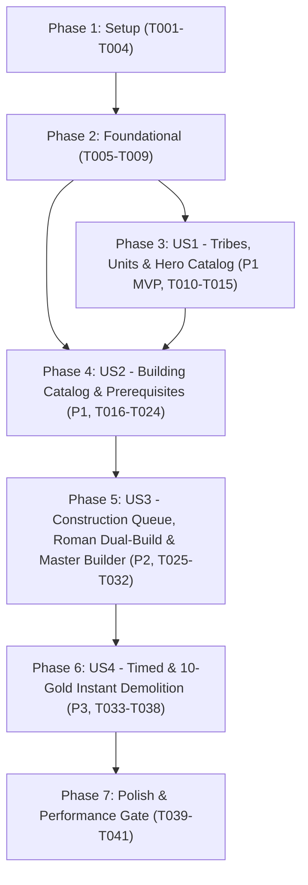

# Tasks: Core Game Catalog (Tribes, Units, Buildings & Construction Rules)

**Input**: Design documents from `/specs/001-core-game-catalog/`
**Prerequisites**: [plan.md](./plan.md) (required), [spec.md](./spec.md) (required for user stories), [research.md](./research.md), [data-model.md](./data-model.md), [contracts/domain-services.md](./contracts/domain-services.md), [contracts/catalog-api.md](./contracts/catalog-api.md), [quickstart.md](./quickstart.md)

**Tests**: Included as mandatory per **Constitutional Principle VI (Test-First & Canonical Mathematical Parity — TDD Mandatory)** and **SC-001..SC-003** in `spec.md`. Write and verify that tests FAIL before implementing the corresponding domain models, rule engines, and actors.

**Organization**: Tasks are grouped by user story (`US1` through `US4`) to enable independent implementation, verification, and incremental delivery.

## Format: `[ID] [P?] [Story] Description`

- **[P]**: Can run in parallel (different files, no dependencies on incomplete tasks)
- **[Story]**: Which user story this task belongs to (`[US1]`, `[US2]`, `[US3]`, `[US4]`)
- Exact repository file paths are included in every task description

---

## Phase 1: Setup (Shared Infrastructure)

**Purpose**: Initialize the 5-project .NET 10 backend solution (`Terravia.Domain`, `Terravia.Actors`, `Terravia.BotAI`, `Terravia.Infrastructure`, `Terravia.WebAPI`), test projects (`Terravia.Domain.Tests`, `Terravia.Actors.Tests`), and shared TypeScript contracts package (`client/packages/game-contracts`) per `plan.md`.

- [X] T001 Create .NET 10 solution `server/Terravia.sln` and class/web project skeletons (`server/src/Terravia.Domain/Terravia.Domain.csproj`, `server/src/Terravia.Actors/Terravia.Actors.csproj`, `server/src/Terravia.BotAI/Terravia.BotAI.csproj`, `server/src/Terravia.Infrastructure/Terravia.Infrastructure.csproj`, `server/src/Terravia.WebAPI/Terravia.WebAPI.csproj`) enforcing pure BCL zero-dependency constraints on `Terravia.Domain`
- [X] T002 [P] Initialize xUnit, FsCheck, and `Akka.TestKit.Xunit2` test projects in `server/tests/Terravia.Domain.Tests/Terravia.Domain.Tests.csproj` and `server/tests/Terravia.Actors.Tests/Terravia.Actors.Tests.csproj` with reference to `specs/001-core-game-catalog/catalog-data.json`
- [X] T003 [P] Initialize TypeScript 5.x strict package structure in `client/packages/game-contracts/package.json` and `client/packages/game-contracts/tsconfig.json`
- [X] T004 [P] Copy and embed canonical catalog dataset (`specs/001-core-game-catalog/catalog-data.json`) as an embedded resource at `server/src/Terravia.Domain/Catalog/Data/catalog-data.json`

---

## Phase 2: Foundational (Blocking Prerequisites)

**Purpose**: Core shared value objects, catalog interfaces, command gateway contracts, and JSON deserialization/hashing primitives that MUST be complete before any user story can be implemented.

**⚠️ CRITICAL**: No user story work can begin until this phase is complete.

- [X] T005 [P] Create `ResourceCost` `readonly record struct` in `server/src/Terravia.Domain/Catalog/Models/ResourceCost.cs` enforcing constraints `Wood >= 0`, `Clay >= 0`, `Iron >= 0`, `Crop >= 0`, and computed `Total` (`Wood + Clay + Iron + Crop`)
- [X] T006 [P] Create `BuildingLevelRequirement` value object and domain enums (`UnitCategory`: `Infantry, Cavalry, Siege, Expansion, Trap`; `UnitTacticalRole` flags: `Infantry, Cavalry, Scout, Ram, Catapult, Chief, Settler, Trap`; `BuildingCategory`: `Resources, ProductionBooster, Storage, Military, Walls, CivicExpansion`; `SlotPlacementRule`: `ResourceField1To18, InnerSlot19To38, RallyPointSlot39, WallSlot40, WorldWonderSlot99`; `CapitalConstraint`: `Any, CapitalOnly, NonCapitalOnly`) in `server/src/Terravia.Domain/Catalog/Models/CatalogEnums.cs`
- [X] T007 [P] Define core domain catalog and rule interfaces (`IGameCatalog`, `IBuildingRuleCatalog`, `IConstructionCalculator`) in `server/src/Terravia.Domain/Catalog/Rules/IGameCatalog.cs`, `server/src/Terravia.Domain/Catalog/Rules/IBuildingRuleCatalog.cs`, and `server/src/Terravia.Domain/Catalog/Rules/IConstructionCalculator.cs` matching `contracts/domain-services.md`
- [X] T008 [P] Define `IGameCommandGateway` and Sitter permission bitmask constants (`SITTER_PERM_GOLD`, build/demolish validation) in `server/src/Terravia.Domain/Commands/IGameCommandGateway.cs`
- [X] T009 Implement JSON catalog loader and deterministic SHA-256 `ContentHash` computation in `server/src/Terravia.Domain/Catalog/Data/CatalogJsonLoader.cs` to hydrate `catalog-data.json` at startup

**Checkpoint**: Foundation ready — user story implementation can now begin.

---

## Phase 3: User Story 1 - Browse & Validate Tribe Profiles and Unit Catalogs (Priority: P1) 🎯 MVP

**Goal**: Provide $O(1)$ zero-allocation access to all 9 tribes (`TribeId 1..9`), 90 unit types (`u1..u90`) + Gaul Traps (`u99`), 35 Hero stat-scaling templates (`h1..h86`), Hero XP/revive tables, and Roman Horse Drinking Trough (`gid 41`) cavalry upkeep calculation.

**Independent Test**: Run `dotnet test server/tests/Terravia.Domain.Tests/Terravia.Domain.Tests.csproj --filter "FullyQualifiedName~TribeAndUnitCatalogEquivalenceTests"` to verify 100% parity of all 9 tribes, 91 units, and 35 hero templates against `specs/001-core-game-catalog/catalog-data.json`, plus Roman cavalry upkeep reductions at Horse Drinking Trough Levels 10, 15, and 20.

### Tests for User Story 1 (TDD — Write First, Must Fail Before Implementation) ⚠️

- [X] T010 [P] [US1] Write golden-vector equivalence tests in `server/tests/Terravia.Domain.Tests/Catalog/TribeAndUnitCatalogEquivalenceTests.cs` asserting all 9 tribes (`1..9`), 91 units (`1..90, 99`), 35 Hero templates (`h1..h86`), unit slot mappings `(T-1)*10 + 1 .. +10`, training building assignments (`u52, u74, u82` -> Barracks `19`), and Roman Horse Drinking Trough upkeep reductions (`u4` @ Lvl 10, `u5` @ Lvl 15, `u6` @ Lvl 20) against `specs/001-core-game-catalog/catalog-data.json`

### Implementation for User Story 1

- [X] T011 [P] [US1] Create `TribeDefinition` model in `server/src/Terravia.Domain/Catalog/Models/TribeDefinition.cs` enforcing constraints: `TribeId` (`1..9`), `Name` (`Non-empty`), `IsPlayable` (`true for 1,2,3,6,7,8,9; false for 4,5`), `MerchantCapacity` (`500 (1,6,8), 750 (3,5,7,9), 1000 (2), 0 (4)`), `MerchantSpeed` (`16 (1,5,7), 14 (8), 12 (2), 24 (3), 20 (6), 18 (9), 0 (4)`), `CrannyMultiplier` (`2.0 for Gauls (3), 1.0 for others`), `WallBuildingTypeId` (`31, 32, 33, 42, 43, 47, 50 (or 0 for Nature)`), `HasDualBuildQueue` (`true for Romans (1)`), `CanBuildResidenceOrPalace` (`false for Huns (6), true for others`), `CommandBuildingTypeIds` (`[25, 26] or [44] for Huns`), `HospitalBuildingTypeId` (`48 for Spartans/Vikings (8,9), 46 for others`), and `UnitIds` (`Length 10 ((TribeId-1)*10 + 1 .. +10)`)
- [X] T012 [P] [US1] Create `UnitDefinition` model in `server/src/Terravia.Domain/Catalog/Models/UnitDefinition.cs` enforcing constraints: `UnitTypeId` (`1..90 or 99`), `TribeId` (`1..9`), `TribeUnitSlot` (`1..10 (0 for u99)`), `Name` (`Non-empty`), `Category` (`Infantry, Cavalry, Siege, Expansion, Trap`), `TacticalRole` (`Flags: Infantry, Cavalry, Scout, Ram, Catapult, Chief, Settler, Trap`), `TrainingBuildingTypeId` (`19 (Barracks), 20 (Stable), 21 (Workshop), 25 (Res/Palace/CC), 36 (Trapper), 0 (NPC)`), `AlternateGreatTrainingBuildingTypeId` (`29 (Great Barracks), 30 (Great Stable), 49 (Great Workshop), or 0`), `Offense` (`>= 0`), `DefenseInfantry` (`>= 0`), `DefenseCavalry` (`>= 0`), `Cost` (`wood, clay, iron, crop`), `UpkeepCropPerHour` (`>= 0`), `SpeedTilesPerHour` (`>= 0`), `BaseTrainingSeconds` (`>= 0`), `CarryCapacity` (`>= 0`), `HorseDrinkingTroughThresholdLevel` (`10 (u4), 15 (u5), 20 (u6), null otherwise`), `ResearchPrerequisites` (`0..2 requirements`), `ResearchCost` (`Present for researchable units`), and `BaseResearchSeconds` (`>= 0`)
- [X] T013 [P] [US1] Create `HeroUnitTemplate` model in `server/src/Terravia.Domain/Catalog/Models/HeroUnitTemplate.cs` enforcing constraints: `UnitTypeId` (`Eligible combat units (5 per playable tribe)`), `BaseAttack` (`> 0`), `AttackPerPoint` (`> 0`), `BaseDefenseInfantry` (`> 0`), `DefenseInfantryPerPoint` (`> 0`), `BaseDefenseCavalry` (`> 0`), and `DefenseCavalryPerPoint` (`> 0`)
- [X] T014 [US1] Implement tribe, unit, and hero template 1-based `ImmutableArray` / `FrozenDictionary` lookup tables in `server/src/Terravia.Domain/Catalog/Rules/FrozenGameCatalog.cs` (`GetAllTribes`, `GetTribe`, `GetAllUnits`, `GetUnit`, `GetUnitsForTribe`, `TryGetHeroTemplate`)
- [X] T015 [US1] Implement `CalculateUnitUpkeepPerHour` in `server/src/Terravia.Domain/Catalog/Rules/ConstructionCalculator.cs` applying Roman Horse Drinking Trough (`gid 41` at Levels 10, 15, and 20 for `u4`, `u5`, `u6`) and Diet Artifact multipliers

**Checkpoint**: User Story 1 (`Tribes, Units & Hero Templates`) is fully functional and independently verified against `catalog-data.json`.

---

## Phase 4: User Story 2 - Evaluate Building Catalog, Level Scaling & Prerequisite Trees (Priority: P1)

**Goal**: Hydrate all 50 building types (`gid 1..50`) with their level progression tables (`Level 1..20`, `1..5`, `1..10`, `1..100`) and enforce all prerequisite rules (`IBuildingRuleCatalog.MeetsPrerequisites`, `EvaluateSlotUpgrade`, `MeetsUnitResearchPrerequisites`), construction duration math, and village Culture Point totals.

**Independent Test**: Run `dotnet test server/tests/Terravia.Domain.Tests/Terravia.Domain.Tests.csproj --filter "FullyQualifiedName~BuildingCatalogAndPrerequisiteTests|FullyQualifiedName~ConstructionCalculatorTests"` to verify 100% of building level tables and positive/negative prerequisite boundary cases across all 50 buildings.

### Tests for User Story 2 (TDD — Write First, Must Fail Before Implementation) ⚠️

- [X] T016 [P] [US2] Write golden-vector tests in `server/tests/Terravia.Domain.Tests/Catalog/BuildingCatalogAndPrerequisiteTests.cs` verifying all 50 buildings (`gid 1..50`) across all levels against `specs/001-core-game-catalog/catalog-data.json`, separate Blacksmith (`12`) and Armoury (`13`), Hun Command Center (`44`) blocking `25/26` and unlocking Stonemason (`34`) at Level 3, Spartan/Viking Big Hospital (`48`) replacing Hospital (`46`), multi-instance `RebuildAtLevel` thresholds (`10, 11, 23, 36, 38, 39`), account-wide Palace (`26`) slot-type check (`Slot 19..40`), World Wonder (`40`) multi-queued Level >= 50 second-plan check, and Academy unit research prerequisites (`r2..r89`)
- [X] T017 [P] [US2] Write unit tests in `server/tests/Terravia.Domain.Tests/Catalog/ConstructionCalculatorTests.cs` verifying `CalculateBuildTimeSeconds` (Main Building `gid 15` Level 0 `5x` penalty, Main Building Level 1..20 `AttributeValue` percentage table, server `Speed` scaling) and `CalculateVillageCulturePoints`

### Implementation for User Story 2

- [X] T018 [P] [US2] Create `BuildingDefinition` and `BuildingLevelStats` models in `server/src/Terravia.Domain/Catalog/Models/BuildingDefinition.cs` and `server/src/Terravia.Domain/Catalog/Models/BuildingLevelStats.cs` enforcing constraints: `BuildingTypeId` (`1..50`), `Name` (`Non-empty`), `Category` (`Resources, ProductionBooster, Storage, Military, Walls, CivicExpansion`), `SlotPlacement` (`ResourceField1To18, InnerSlot19To38, RallyPointSlot39, WallSlot40, WorldWonderSlot99`), `MaxLevel` (`5 (gid 5..9), 10 (gid 23, 35), 100 (gid 40), 20 (all others)`), `NonCapitalMaxLevel` (`10 for gid 1..4; 0 for CapitalOnly; MaxLevel otherwise`), `CapitalConstraint` (`Any, CapitalOnly, NonCapitalOnly`), `AllowedTribeIds`, `DeniedTribeIds` (`[6] for 25, 26; [8, 9] for 46`), `MinLevelRequirements`, `ExactLevelRequirements`, `IsUniquePerVillage` (`false for 1..4 and walls; true for others`), `RebuildAtLevel` (`20 for 10, 11, 36, 38, 39; 10 for 23; null otherwise`), `IsAccountWideUnique` (`true for Palace (26)`), `RequiresGreatStorageQualification` (`true for 38, 39`), `CanFinishInstantlyWithGold` (`false for 25, 26, 40; true for others`), and `Levels` (`Indexed 1..MaxLevel (plus 0 for gid 1..4 base prod=2)`)
- [X] T019 [P] [US2] Create `VillagePrerequisiteContext`, `VillageConstructionContext`, and `BuildSlotEvaluation` value structs in `server/src/Terravia.Domain/Catalog/Models/BuildingEvaluationContexts.cs` enforcing validation invariants (`SlotBeingDemolished`, `MaxLevelReached`, `MaxLevelUnderConstruction`, `QueueFull`, `WarehouseCapacityInsufficient`, `GranaryCapacityInsufficient`, `InsufficientResources`, `CropStarvationBlock`)
- [X] T020 [US2] Extend `FrozenGameCatalog` in `server/src/Terravia.Domain/Catalog/Rules/FrozenGameCatalog.cs` to hydrate `GetAllBuildings`, `GetBuilding`, and `GetBuildingLevelStats` from `catalog-data.json`
- [X] T021 [US2] Implement `BuildingRuleCatalog` (`MeetsPrerequisites`, `EvaluateSlotUpgrade`, `MeetsUnitResearchPrerequisites`) in `server/src/Terravia.Domain/Catalog/Rules/BuildingRuleCatalog.cs` covering declarative rules and special-case evaluators (`gid 25, 26, 34, 38, 39, 40, 49`)
- [X] T022 [US2] Implement `CalculateBuildTimeSeconds` and `CalculateVillageCulturePoints` in `server/src/Terravia.Domain/Catalog/Rules/ConstructionCalculator.cs` using exact Main Building `AttributeValue` percentages and `ReadOnlySpan<int>` slot arrays
- [X] T023 [P] [US2] Implement `GET /api/game/catalog` endpoint with deterministic `ETag` / `If-None-Match` (`304 Not Modified`) caching in `server/src/Terravia.WebAPI/Endpoints/GameCatalogEndpoints.cs` matching `contracts/catalog-api.md`
- [X] T024 [P] [US2] Create shared TypeScript catalog DTOs (`GameCatalogDto`, `TribeDto`, `UnitDto`, `HeroTemplateDto`, `BuildingDto`, `BuildingLevelDto`) and pure client-side prerequisite/cost helpers in `client/packages/game-contracts/src/catalog.types.ts` and `client/packages/game-contracts/src/construction.helpers.ts`

**Checkpoint**: User Stories 1 AND 2 (`Complete Game Catalog, Prerequisite Engine & Hash-Cached Catalog API`) work independently and pass all golden-vector tests.

---

## Phase 5: User Story 3 - Execute Construction Queues, Roman Dual-Build & Master Builder Reservations (Priority: P2)

**Goal**: Implement the deterministic Village Construction Queue state machine (`VillageConstructionManager` & `VillageActor`), supporting standard single-slot execution, Roman simultaneous Resource Field (`Slot 1..18`) + Inner Building (`Slot 19..40, 99`) execution, Plus Subscription waiting loop (`ceil(60 / Speed)` delay), Master Builder deferred-deduction reservations (`IsMasterBuilder = true`), cancellation refunds, and Gold "Finish All" with WW/Residence/Palace exclusions.

**Independent Test**: Run `dotnet test server/tests/Terravia.Actors.Tests/Terravia.Actors.Tests.csproj --filter "FullyQualifiedName~VillageConstructionQueueActorTests"` using `Akka.TestKit` virtual time to verify Roman vs. non-Roman concurrency, Plus waiting-loop chaining, Master Builder auto-activation, cancellation refunds, and "Finish All" exclusions.

### Tests for User Story 3 (TDD — Write First, Must Fail Before Implementation) ⚠️

- [X] T025 [P] [US3] Write unit and property-based queue transition tests in `server/tests/Terravia.Domain.Tests/Villages/VillageConstructionManagerTests.cs` covering multi-level same-slot queueing (`TargetLevel = CurrentLevel + 1 + PriorQueuedForSameSlot`), Roman dual-queue partitioning, Plus loop chaining (`+ ceil(60 / Speed)`), Master Builder promotion, cancellation refunds (`100%` for active/loop capped at storage vs. `0` for Master Builder), and "Finish All" (`gid 25, 26, 40` & WW village exclusions)
- [X] T026 [P] [US3] Write `Akka.TestKit` virtual-time actor tests in `server/tests/Terravia.Actors.Tests/Villages/VillageConstructionQueueActorTests.cs` verifying concurrent command handling, `ITimerScheduler` completion ordering, Master Builder promotion upon resource accrual/slot completion, and Sitter `TerraviaPermissions.Sitter.GoldMask` enforcement

### Implementation for User Story 3

- [X] T027 [P] [US3] Create `VillageState` (`SlotBuildingTypes: int[41]`, `SlotLevels: int[41]`, `WorldWonderBuildingType`, `WorldWonderLevel`) and `ConstructionQueueItem` (`QueueItemId`, `VillageId`, `SlotId` `1..40 or 99`, `BuildingTypeId` `1..50`, `TargetLevel`, `IsWaitingLoop`, `IsMasterBuilder`, `StartedAtMs`, `FinishesAtMs`) in `server/src/Terravia.Domain/Villages/VillageState.cs` and `server/src/Terravia.Domain/Villages/ConstructionQueueItem.cs`
- [X] T028 [P] [US3] Define construction command records (`ConstructOrUpgradeBuildingCommand`, `CancelConstructionJobCommand`, `FinishAllConstructionsWithGoldCommand`) in `server/src/Terravia.Domain/Commands/ConstructionCommands.cs` matching `contracts/domain-services.md`
- [X] T029 [US3] Implement pure queue transition logic in `server/src/Terravia.Domain/Villages/VillageConstructionManager.cs` (enqueue active/Plus-loop/Master-Builder jobs, promote `WaitingLoop` and `MasterBuilder` items, cancel job with storage-capped refund, complete level upgrade updating `pop`, `cp`, and `Warehouse/Granary` capacity, and execute `FinishAll` with WW/Residence/Palace exclusions)
- [X] T030 [US3] Implement `VillageActor` construction command handlers and `ITimerScheduler` scheduling in `server/src/Terravia.Actors/Villages/VillageActor.cs` with lazy resource evaluation on command arrival and immediate persistence flush on Gold expenditure
- [X] T031 [P] [US3] Create persistence models (`VillageBuilding`, `VillageQueueItem`) and Dapper TVP hydration/write-behind repository methods in `server/src/Terravia.Infrastructure/Persistence/Villages/VillageBuilding.cs`, `server/src/Terravia.Infrastructure/Persistence/Villages/VillageQueueItem.cs`, and `server/src/Terravia.Infrastructure/Persistence/Dapper/VillageStateRepository.cs`
- [X] T032 [P] [US3] Add `VillageConstructionDeltaDto` TypeScript contract in `client/packages/game-contracts/src/catalog.types.ts` and broadcast `VillageConstructionChangedEto` from `VillageActor` via `SignalRBridgeActor`

**Checkpoint**: User Story 3 (`Construction Queue, Roman Dual-Queue, Plus Loop, Master Builder & Finish All`) is complete and verified under virtual time.

---

## Phase 6: User Story 4 - Demolish Village Buildings Level-by-Level (Priority: P3)

**Goal**: Enable timed 1-level demolition (`floor(buildTime / 2)`), 2-Gold "Finish All" completion of an active demolition, and 10-Gold instant complete demolition to Level 0 in the Main Building (`gid 15 >= 10`), while enforcing the Alliance Founder Embassy (`gid 18`) demolition safeguard.

**Independent Test**: Run `dotnet test server/tests/Terravia.Actors.Tests/Terravia.Actors.Tests.csproj --filter "FullyQualifiedName~Demolition"` to verify Main Building Level >= 10 enforcement, single active demolition per village, level decrement and slot-type clearance at Level 0, 10-Gold instant raze to Level 0, and Alliance Founder Embassy protection.

### Tests for User Story 4 (TDD — Write First, Must Fail Before Implementation) ⚠️

- [X] T033 [P] [US4] Write unit tests in `server/tests/Terravia.Domain.Tests/Villages/BuildingDemolitionTests.cs` verifying `EvaluateDemolition` (Main Building `< 10` rejected, active upgrade on slot rejected, Alliance Founder Embassy `gid 18` safeguard when `AllianceMemberCount > 1` and last qualifying Embassy), `CalculateDemolitionTimeSeconds` (`floor(buildTime / 2.0)`), timed 1-level decrement, and 10-Gold instant complete demolition subtracting $\sum_{i=1}^{L} \text{pop}(i)$ and recalculating storage/CP
- [X] T034 [P] [US4] Write `Akka.TestKit` virtual-time tests in `server/tests/Terravia.Actors.Tests/Villages/VillageDemolitionActorTests.cs` verifying timed demolition completion, cancellation (`CancelBuildingDemolitionCommand`), 2-Gold `FinishAll` completing an active demolition, and 10-Gold instant complete demolition to Level 0

### Implementation for User Story 4

- [X] T035 [P] [US4] Create `DemolitionQueueItem` (`VillageId`, `SlotId` `19..40 or 99`, `TargetLevel` `max(0, CurrentLevel - 1)`, `FinishesAtMs` `NowMs + floor(CurrentLevelBuildTimeSeconds / 2.0) * 1000`), `VillageDemolitionContext`, and `DemolitionEligibilityResult` in `server/src/Terravia.Domain/Villages/DemolitionQueueItem.cs`
- [X] T036 [P] [US4] Define demolition command records (`StartBuildingDemolitionCommand`, `CancelBuildingDemolitionCommand`) in `server/src/Terravia.Domain/Commands/ConstructionCommands.cs` matching `contracts/domain-services.md`
- [X] T037 [US4] Implement `EvaluateDemolition` in `server/src/Terravia.Domain/Catalog/Rules/BuildingRuleCatalog.cs` and `CalculateDemolitionTimeSeconds` in `server/src/Terravia.Domain/Catalog/Rules/ConstructionCalculator.cs`
- [X] T038 [US4] Extend `VillageConstructionManager` in `server/src/Terravia.Domain/Villages/VillageConstructionManager.cs` and `VillageActor` in `server/src/Terravia.Actors/Villages/VillageActor.cs` to handle `StartBuildingDemolitionCommand` (timed 1-level & 10-Gold instant raze to Level 0), `CancelBuildingDemolitionCommand`, demolition timer completion (clearing slot `BuildingTypeId = 0` and queued upgrades when reaching Level 0), and immediate persistence flush on 10-Gold expenditure

**Checkpoint**: All 4 user stories (`US1..US4`) are complete and independently verified.

---

## Phase 7: Polish & Cross-Cutting Concerns

**Purpose**: Performance benchmarking (`SC-004` `< 1ms` full-village evaluation), edge-case hardening, and end-to-end quickstart verification.

- [X] T039 [P] Add micro-benchmark / performance assertion test in `server/tests/Terravia.Domain.Tests/Catalog/CatalogPerformanceTests.cs` verifying full-village 40-slot + WW prerequisite and upgrade evaluation completes in `< 1ms` (`SC-004`) with zero heap allocations
- [X] T040 [P] Register `IGameCatalog`, `IBuildingRuleCatalog`, `IConstructionCalculator`, and `GameCatalogEndpoints` in `server/src/Terravia.WebAPI/Program.cs` DI container
- [X] T041 Run full test suite (`dotnet test server/Terravia.sln`) and execute `specs/001-core-game-catalog/quickstart.md` verification steps

---

## Dependencies & Execution Order

### Phase Dependencies

- **Phase 1: Setup (`T001..T004`)**: No dependencies — can start immediately.
- **Phase 2: Foundational (`T005..T009`)**: Depends on Phase 1 — **BLOCKS** all user stories (`US1..US4`).
- **Phase 3: User Story 1 (`T010..T015`, P1 🎯 MVP)**: Depends on Phase 2 (`Foundational`). No dependencies on other user stories.
- **Phase 4: User Story 2 (`T016..T024`, P1)**: Depends on Phase 2 (`Foundational`) and integrates with `FrozenGameCatalog` (`US1`) to expose the unified `IGameCatalog` and `GET /api/game/catalog`.
- **Phase 5: User Story 3 (`T025..T032`, P2)**: Depends on Phase 4 (`US2` `IBuildingRuleCatalog` & `IConstructionCalculator`).
- **Phase 6: User Story 4 (`T033..T038`, P3)**: Depends on Phase 4 (`US2`) and extends `VillageConstructionService` / `VillageActor` (`US3`).
- **Phase 7: Polish (`T039..T041`)**: Depends on Phases 3–6 completion.

### User Story Dependency Graph



### Parallel Opportunities

- **Setup (`Phase 1`)**: `T002`, `T003`, and `T004` can run in parallel after `T001`.
- **Foundational (`Phase 2`)**: `T005`, `T006`, `T007`, and `T008` touch separate files and can run in parallel.
- **User Story 1 (`Phase 3`)**: `T011` (`TribeDefinition.cs`), `T012` (`UnitDefinition.cs`), and `T013` (`HeroUnitTemplate.cs`) can be implemented in parallel after `T010`.
- **User Story 2 (`Phase 4`)**: `T016` and `T017` (tests) can run in parallel; `T018` and `T019` (models) can run in parallel; `T023` (`.NET WebAPI endpoint`) and `T024` (`TypeScript game-contracts`) can run in parallel.
- **User Story 3 (`Phase 5`)**: `T025` and `T026` (tests) can run in parallel; `T027` and `T028` (models/commands) can run in parallel; `T031` (`Infrastructure persistence`) and `T032` (`TypeScript delta contracts`) can run in parallel.
- **User Story 4 (`Phase 6`)**: `T033` and `T034` (tests) can run in parallel; `T035` and `T036` (models/commands) can run in parallel.

---

## Parallel Example: User Story 1 & User Story 2

```bash
# User Story 1 — Launch all domain model implementations in parallel after writing T010:
Task T011: "Create TribeDefinition model in server/src/Terravia.Domain/Catalog/Models/TribeDefinition.cs"
Task T012: "Create UnitDefinition model in server/src/Terravia.Domain/Catalog/Models/UnitDefinition.cs"
Task T013: "Create HeroUnitTemplate model in server/src/Terravia.Domain/Catalog/Models/HeroUnitTemplate.cs"

# User Story 2 — Launch WebAPI catalog endpoint and TypeScript contracts in parallel once FrozenGameCatalog is ready:
Task T023: "Implement GET /api/game/catalog endpoint in server/src/Terravia.WebAPI/Endpoints/GameCatalogEndpoints.cs"
Task T024: "Create shared TypeScript catalog DTOs in client/packages/game-contracts/src/catalog.types.ts"
```

---

## Implementation Strategy

### MVP First (User Story 1 + User Story 2 — P1 Catalog & Prerequisite Core)

1. Complete **Phase 1: Setup** (`T001..T004`) and **Phase 2: Foundational** (`T005..T009`).
2. Complete **Phase 3: User Story 1** (`T010..T015`) and validate 100% Tribe/Unit/Hero parity against `catalog-data.json`.
3. Complete **Phase 4: User Story 2** (`T016..T024`) and validate 100% Building level/prerequisite parity + `GET /api/game/catalog`.
4. **STOP and VALIDATE**: Confirm all `Terravia.Domain.Tests` golden-vector suites pass (`SC-001`, `SC-002`).

### Incremental Delivery

1. **Foundation (`Phases 1–2`)**: Project structure, shared `ResourceCost` / enums, interfaces, and JSON loader ready.
2. **Increment 1 (`Phase 3 — US1`)**: All 9 tribes, 91 units, 35 hero templates, and Roman cavalry upkeep rules tested and live.
3. **Increment 2 (`Phase 4 — US2`)**: All 50 buildings, prerequisite trees, construction time/CP calculators, and `GET /api/game/catalog` endpoint live.
4. **Increment 3 (`Phase 5 — US3`)**: `VillageActor` construction queue, Roman dual-queue, Plus waiting loop, Master Builder reservations, and Gold "Finish All" live.
5. **Increment 4 (`Phase 6 — US4`)**: Timed 1-level demolition, 10-Gold instant complete demolition to Level 0, and Alliance Founder Embassy protection live.


---

## Phase 8: Convergence

- [X] T042 Add 1,000+ randomized command-sequence simulation test (`SC-003`) and storage-capped active/Plus-loop cancellation refund test in `server/tests/Terravia.Domain.Tests/Villages/VillageConstructionManagerTests.cs` per SC-003 / T025 (partial)
- [X] T043 Implement Dapper actor hydration methods (`ApplyHydratedRows` and `HydrateVillageStateAsync`) in `server/src/Terravia.Infrastructure/Persistence/Dapper/VillageStateRepository.cs` per T031 (partial)
- [X] T044 Emit `VillageConstructionChangedEto` from `VillageActor` via `SignalRBridgeActor` observer in `server/src/Terravia.Actors/Villages/VillageActor.cs` and verify in `server/tests/Terravia.Actors.Tests/Villages/VillageConstructionQueueActorTests.cs` per T032 (partial)
