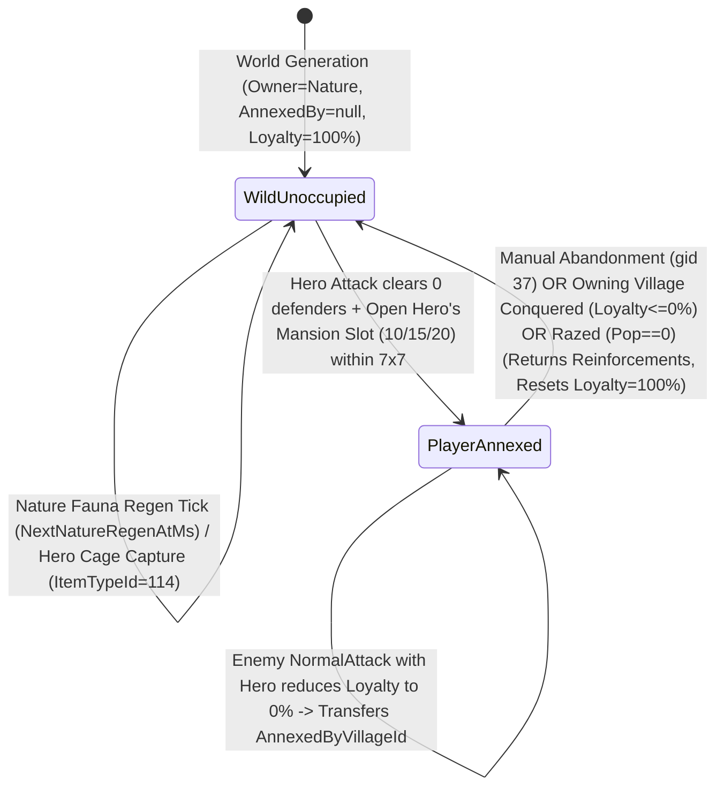

# Phase 1 Data Model: Core Economy, Village Resource Engine, Oasis Ecology, Starvation Mechanics & Village Expansion Rules

**Feature**: `002-economy-village-engine`  
**Date**: 2026-11-06  
**Spec**: [spec.md](./spec.md) | **Research**: [research.md](./research.md)

---

## 1. Village Economy, Topologies & Expansion State (`Terravia.Domain.Villages`)

Per **Constitutional Principle I & II** and **Naming & Structural Conventions**, all domain and persistence models use clean singular nouns (no `Entity` suffix), reside in vertical feature folders (`Terravia.Domain.Villages`, `Terravia.Domain.Oases`, `Terravia.Domain.Players`), and keep `1` primary type per `.cs` file.

### 1.1 `FieldTopologyDefinition` (`FieldTopologyId: 1..12`)
Immutable lookup record stored in `VillageFieldTopologyCatalog`:

| Field | Type | Constraints | Description |
| :--- | :--- | :--- | :--- |
| `FieldTopologyId` | `int` | `1..12` | Canonical village topology ID (`Type 1` = `3-3-3-9` 9-cropper, `Type 3` = `4-4-4-6` standard, `Type 6` = `1-1-1-15` 15-cropper) |
| `WoodFields` | `int` | `1..5` | Count of `Woodcutter` (`gid 1`) slots |
| `ClayFields` | `int` | `1..5` | Count of `Clay Pit` (`gid 2`) slots |
| `IronFields` | `int` | `1..5` | Count of `Iron Mine` (`gid 3`) slots |
| `CropFields` | `int` | `6..15` | Count of `Cropland` (`gid 4`) slots |
| `SlotResourceTypes` | `ImmutableArray<int>` | Length `19` (`1..18` 1-based) | Exact `BuildingTypeId` (`1..4`) for each outer slot `Slot 1..18` |

### 1.2 `Village` / `VillageState` (Aggregate State in `VillageActor` & `Villages` Table)

| Field | Type | Constraints | Description |
| :--- | :--- | :--- | :--- |
| `VillageId` | `int` | PK, `> 0` | Unique village identifier |
| `TileId` | `int` | Unique FK -> `MapTiles.TileId` | World map tile coordinate reference |
| `OwnerPlayerId` | `int` | FK -> `Players.PlayerId` | Owning player ID |
| `OwnerTribeId` | `int` | `1..9` (`!= 4`) | Owning player's tribe (`1..3, 5..9`) |
| `Name` | `string` | `1..64` chars | Village display name |
| `FieldTopologyId` | `int` | `1..12` | Outer resource field layout (`Slot 1..18`) |
| `IsCapital` | `bool` | Max `1` per player; `false` if `IsArchon` | Capital designation (`true` allows `Slot 1..18` up to `Lvl 20`, `gid 34`, `gid 35`) |
| `IsArchon` | `bool` | Immutable World Wonder village flag | `true` for the 13 `Archon` World Wonder villages (`50%` upkeep, `0` passive CP, never Capital) |
| `IsWwBuildingPlanVillage` | `bool` | Immutable flag | `true` for `Archon` WW Building Plan villages (cannot be conquered via Administrators) |
| `Population` | `int` | `>= 0` (`2` on founding) | Sum of building population across `Slot 1..40, 99` (`0` triggers village razing) |
| `CulturePointsPerDay` | `int` | `>= 0` (`0` if `IsArchon == true`) | Base daily CP from `Slot 1..40` scaled by Alliance Philosophy bonus |
| `Loyalty` | `double` | `0.0 .. 100.0` | Current village loyalty (`100.0` on founding; `0.0` triggers conquest) |
| `Wood` | `double` | `0.0 .. WarehouseCap` | Current stored Wood (`750` on founding) |
| `Clay` | `double` | `0.0 .. WarehouseCap` | Current stored Clay (`750` on founding) |
| `Iron` | `double` | `0.0 .. WarehouseCap` | Current stored Iron (`750` on founding) |
| `Crop` | `double` | `0.0 .. GranaryCap` | Current stored Crop (`750` on founding) |
| `WarehouseCap` | `int` | `>= BaseStorageCapacity` | Sum of `Warehouse (10)` + `Great Warehouse (38)` capacities $\times \text{StorageMultiplier}$ (floor `800 * StorageMultiplier`) |
| `GranaryCap` | `int` | `>= BaseStorageCapacity` | Sum of `Granary (11)` + `Great Granary (39)` capacities $\times \text{StorageMultiplier}$ (floor `800 * StorageMultiplier`) |
| `LastUpdatedMs` | `long` | UTC epoch ms | Timestamp of last lazy resource & loyalty accrual |
| `ActiveCelebrationType` | `CelebrationType` | `None (0), Small (1), Great (2)` | Active `Town Hall` (`gid 24`) celebration type |
| `CelebrationEndsAtMs` | `long` | UTC epoch ms (`0` if none) | Completion timestamp of active `Town Hall` celebration |
| `FestivalEndsAtMs` | `long` | UTC epoch ms (`0` if none) | Completion timestamp of active Teuton `Brewery` (`gid 35`) Mead Festival (Capital only) |
| `ExpansionSlot1VillageId` | `int?` | Nullable FK -> `Villages.VillageId` | 1st daughter village founded or conquered from this village |
| `ExpansionSlot2VillageId` | `int?` | Nullable FK -> `Villages.VillageId` | 2nd daughter village founded or conquered from this village |
| `ExpansionSlot3VillageId` | `int?` | Nullable FK -> `Villages.VillageId` | 3rd daughter village founded or conquered from this village |
| `TotalTrapsCount` | `int` | `0..400` (`u99`) | Total Gaul traps constructed in `Trapper` (`gid 36`) |
| `OccupiedTrapsCount` | `int` | `0..TotalTrapsCount` | Traps currently occupied by `Trapped` prisoner stacks |

### 1.3 `ResourceProductionSnapshot` (`readonly record struct`)
Returned by `ResourceProductionCalculator.CalculateProduction`:

| Field | Type | Description |
| :--- | :--- | :--- |
| `GrossWoodPerHour` | `int` | Step 1..6 rounded hourly Wood production |
| `GrossClayPerHour` | `int` | Step 1..6 rounded hourly Clay production |
| `GrossIronPerHour` | `int` | Step 1..6 rounded hourly Iron production |
| `GrossCropPerHour` | `int` | Step 1..6 rounded hourly Crop production (used identically by normal ticks and `StarvationCalculator`) |
| `EffectivePopulationUpkeep` | `int` | $\lceil \text{Population} / 2.0 \rceil$ if `IsArchon`, else `Population` |
| `TotalTroopUpkeepPerHour` | `int` | Sum of crop upkeep across all 5 non-`Nature` troop categories fed by this village (with `gid 41`, `IsArchon` `50%`, and `Diet Control` artifact modifiers) |
| `NetCropPerHour` | `int` | `GrossCropPerHour - EffectivePopulationUpkeep - TotalTroopUpkeepPerHour` |

---

## 2. Map Tile & Oasis Ecology State (`Terravia.Domain.Oases`)

### 2.1 `OasisTypeDefinition` (`OasisTypeId: 1..12`)
Immutable catalog record in `OasisEcologyCatalog`:

| Field | Type | Constraints | Description |
| :--- | :--- | :--- | :--- |
| `OasisTypeId` | `int` | `1..12` | Canonical oasis type (`1..2` Wood, `3` Wood+Crop, `4..5` Clay, `6` Clay+Crop, `7..8` Iron, `9` Iron+Crop, `10..11` `+25%` Crop, `12` `+50%` Crop) |
| `WoodBonusUnits` | `int` | `0..1` | Count of `+25%` Wood bonus units (`1` for `Type 1, 2, 3`) |
| `ClayBonusUnits` | `int` | `0..1` | Count of `+25%` Clay bonus units (`1` for `Type 4, 5, 6`) |
| `IronBonusUnits` | `int` | `0..1` | Count of `+25%` Iron bonus units (`1` for `Type 7, 8, 9`) |
| `CropBonusUnits` | `int` | `0..2` | Count of `+25%` Crop bonus units (`1` for `Type 3, 6, 9, 10, 11`; `2` for `Type 12`) |
| `FaunaSpawnRules` | `ImmutableArray<OasisFaunaSpawnRule>` | `3..6` rules | `(UnitTypeId [31..40], BaseMinIncrement, RandomRangeMax)` per regeneration tick |

### 2.2 `MapTile` (`MapTiles` Table)

| Field | Type | Constraints | Description |
| :--- | :--- | :--- | :--- |
| `TileId` | `int` | PK, `1 .. (2R+1)^2` | Unique 1-based tile index on the toroidal grid |
| `X` | `short` | `-MapRadius .. +MapRadius` | Toroidal X coordinate |
| `Y` | `short` | `-MapRadius .. +MapRadius` | Toroidal Y coordinate |
| `FieldTopologyId` | `byte` | `0` (Oasis/Wilderness) or `1..12` | Habitable village field topology (`Type 1..12`) |
| `OasisTypeId` | `byte` | `0` (Non-Oasis) or `1..12` | Oasis bonus type (`Type 1..12`) |
| `BestOasisCropBonus` | `byte` | `0, 25, 50, 75, 100, 125, 150` | Precomputed sum of top `3` crop oases (`Type 12`=`50`, `Types 3,6,9,10,11`=`25`) within `7x7` toroidal radius for `Type 1` & `Type 6` tiles |
| `OccupiedByVillageId` | `int?` | Nullable FK -> `Villages.VillageId` | Present when a village occupies this habitable tile |

### 2.3 `OasisState` (Aggregate State in `OasisActor` & `OasisState` Table)

| Field | Type | Constraints | Description |
| :--- | :--- | :--- | :--- |
| `TileId` | `int` | PK, FK -> `MapTiles.TileId` | Oasis map tile ID |
| `OasisTypeId` | `byte` | `1..12` | Oasis bonus & fauna spawn type |
| `RichnessTier` | `byte` | `0, 1, 2` | Fauna cap difficulty tier (`0`=Low `30`, `1`=Medium `60`, `2`=High `90`) |
| `AnnexedByVillageId` | `int?` | Nullable FK -> `Villages.VillageId` | `null` when wild (`Nature`), or owning `VillageId` when annexed |
| `OwnerPlayerId` | `int` | `2` (`Nature`) or Player ID | Owning player ID (updated or reset to `Nature` on annexation/abandonment/conquest) |
| `Loyalty` | `double` | `0.0 .. 100.0` | Oasis loyalty (`100.0` when wild; regenerates at `HeroMansionLevel * Speed` %/hr when annexed) |
| `Wood` | `double` | `0.0 .. 800.0` | Wild oasis Wood stock (`10 * Speed`/hr accrual when wild) |
| `Clay` | `double` | `0.0 .. 800.0` | Wild oasis Clay stock (`10 * Speed`/hr accrual when wild) |
| `Iron` | `double` | `0.0 .. 800.0` | Wild oasis Iron stock (`10 * Speed`/hr accrual when wild) |
| `Crop` | `double` | `0.0 .. 800.0` | Wild oasis Crop stock (`10 * Speed`/hr, or `20 * Speed`/hr for `OasisTypeId == 12`) |
| `LastUpdatedMs` | `long` | UTC epoch ms | Last lazy resource/loyalty evaluation timestamp |
| `NextNatureRegenAtMs` | `long` | UTC epoch ms | Next scheduled `Nature` fauna regeneration timestamp (`NowMs + NatureRegenIntervalSeconds * 1000`) |

---

## 3. Troop Stacks & Starvation Candidate Model (`Terravia.Domain.Villages`)

### 3.1 `VillageTroopStack` (`VillageTroopStacks` Table)
To support zero-allocation evaluation, in-memory troop stacks store unit counts in a contiguous `int[10]` (tribe-relative) or `int[91]` (`u1..u90`) array plus `HeroCount` (`0` or `1`), while SQL persistence stores normalized `VillageTroopStack` rows:

| Field | Type | Constraints | Description |
| :--- | :--- | :--- | :--- |
| `StackId` | `long` | PK | Unique troop stack row ID (`FIFO` tie-breaker across reinforcement rows) |
| `LocationTileId` | `int` | FK -> `MapTiles.TileId` | Village or Oasis tile where the stack is stationed |
| `FeedingVillageId` | `int` | FK -> `Villages.VillageId` | Village paying crop upkeep for this stack |
| `OwnerVillageId` | `int` | `0` for captured `Nature` fauna, else FK | Home village that owns these troops (`0` = non-recallable captured `Nature` animals with `0` upkeep) |
| `StackType` | `TroopStackType` | `Home, OasisReinforcement, VillageReinforcement, Trapped, Hospital` | Determines starvation tier (`Tier 1..4`) and upkeep eligibility |
| `UnitCounts` | `int[91]` | `UnitCounts[1..90] >= 0` | Counts per `UnitTypeId` (`u1..u90`) |
| `HasHero` | `bool` | `true` if Hero is in this stack | Hero starves **only** if all `UnitCounts[1..90] == 0` in this stack |

### 3.2 `StarvationStepResult` (`readonly record struct`)
Returned by `StarvationCalculator.ResolveStarvationStep`:

| Field | Type | Description |
| :--- | :--- | :--- |
| `StarvedTier` | `StarvationPriorityTier` | `OasisReinforcement (1), VillageReinforcement (2), TrappedPrisoner (3), OwnStationed (4), OwnMoving (5)` |
| `TargetStackOrMovementId` | `long` | `StackId` or `MovementId` from which the unit was eliminated |
| `StarvedUnitTypeId` | `int` | `1..90`, or `0` if `Hero` starved |
| `IsHeroStarved` | `bool` | `true` when all `u1..u90` in the target stack were `0` and the Hero starved (`IsDead = true, Health = 0`) |
| `CreditedCrop` | `int` | Base training `CropCost` of `StarvedUnitTypeId` (or `6` for Hero) added to `Village.Crop` |
| `ShouldDeleteEmptyStackOrMovement` | `bool` | `true` when the target `Reinforcement`, `Trapped`, or `Movement` now has `0` total units and `0` Hero left |
| `FreedTrapCount` | `int` | `1` if `StarvedTier == TrappedPrisoner` (decrements both `TotalTrapsCount` and `OccupiedTrapsCount`), else `0` |

---

## 4. Culture Points & Expansion Ledger (`Terravia.Domain.Players`)

### 4.1 `PlayerCultureLedger` (In-Memory State in `PlayerActor` & `Players` Table)

| Field | Type | Constraints | Description |
| :--- | :--- | :--- | :--- |
| `PlayerId` | `int` | PK | Player identifier |
| `AccumulatedCulturePoints` | `double` | `>= 0.0` | Total accrued Culture Points (including completed `Town Hall` celebrations) |
| `TotalVillageBaseCpPerDay` | `int` | `>= 0` | Sum of `CulturePointsPerDay` across all owned non-`Archon` villages (`IsArchon == false`) |
| `HeroHelmetCpPerDay` | `int` | `0..2400 * Speed` | Daily CP bonus from equipped Gladiator/Tribune/Consul Helmet |
| `AlliancePhilosophyMultiplier` | `double` | `1.00 .. 1.10` | Active Alliance Philosophy bonus (`+2%..+10%`) |
| `LastCpUpdatedMs` | `long` | UTC epoch ms | Timestamp of last lazy CP accrual |
| `OwnedVillageCount` | `int` | `>= 1` | Current count of villages owned by the player |
| `CapitalVillageId` | `int` | FK -> `Villages.VillageId` | Current Capital village ID (`IsCapital == true`, never `IsArchon`) |

---

## 5. Key State Transitions

### 5.1 Oasis Lifecycle & Ownership State Machine

### 5.2 Village Expansion, Capital Transfer & Conquest State Machine

```mermaid
stateDiagram-v2
    [*] --> NewlyFounded : 3 Settlers + 750 W/C/I/Crop + Free ExpansionSlot + CP >= Threshold(N+1) (Main Building Lvl 1, Pop=2, CP=1, Loyalty=100%)
    NewlyFounded --> NonCapitalVillage : Normal Development (Outer Fields capped at Lvl 10)
    NonCapitalVillage --> CapitalVillage : Designate Capital via Palace (26) / Command Center (44) (Not IsArchon; Destroys gid 29,30,38,39,49 in new Capital; Downgrades old Capital Slot 1..18 >10 to 10 & destroys gid 34,35)
    CapitalVillage --> NonCapitalVillage : Another Village Designated as Capital

    NonCapitalVillage --> ConqueredByAttacker : NormalAttack with surviving Administrators drops Loyalty <= 0% (Consumes 1 Admin, Pre-Conquest Pop Penalty -1 Lvl, Destroys Tribe-Incompatible Buildings & Wall, Releases Annexed Oases, Cancels All Queues, Resets Tech/Smithy/Hospital/Routes, Rebinds ExpansionSlot)
    NonCapitalVillage --> RazedToEmptyTile : Catapults reduce Population == 0 (Releases Oases, Frees Parent ExpansionSlot)
```

