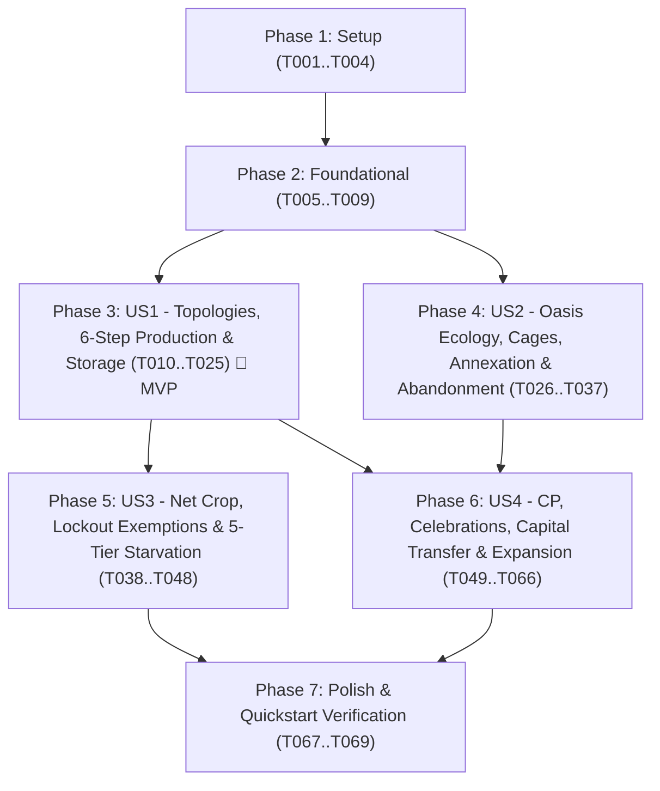

---

description: "Task list for Core Economy, Village Resource Engine, Oasis Ecology, Starvation Mechanics & Village Expansion Rules"
---

# Tasks: Core Economy, Village Resource Engine, Oasis Ecology, Starvation Mechanics & Village Expansion Rules

**Input**: Design documents from `/specs/002-economy-village-engine/`
**Prerequisites**: [plan.md](./plan.md) (required), [spec.md](./spec.md) (required for user stories), [research.md](./research.md), [data-model.md](./data-model.md), [contracts/domain-services.md](./contracts/domain-services.md), [contracts/economy-expansion-api.md](./contracts/economy-expansion-api.md), [quickstart.md](./quickstart.md)

**Tests**: Per **Constitutional Principle VI (Test-First & Canonical Mathematical Parity - TDD Mandatory)** and `quickstart.md`, golden-vector xUnit tests (`Terravia.Domain.Tests`) and `Akka.TestKit` virtual-time actor tests (`Terravia.Actors.Tests`) are included at the start of each User Story phase and MUST be written to fail before implementing the corresponding domain calculators, managers, and actors.

**Organization**: Tasks are grouped by user story (`US1` through `US4`) in strict adherence to the **One-Type-Per-File (`1:1`)** and **Vertical Feature-Folder** (`Villages/`, `Oases/`, `Players/`) rules in the [Terravia Renatus Constitution](../../.specify/memory/constitution.md).

## Format: `[ID] [P?] [Story] Description`

- **[P]**: Can run in parallel (different files, no dependencies on incomplete tasks)
- **[Story]**: Which user story this task belongs to (`[US1]`, `[US2]`, `[US3]`, `[US4]`)
- Every task includes its exact repository-relative file path and quotes constraints from `data-model.md` verbatim.

## Path Conventions

- **Domain Layer**: `server/src/Terravia.Domain/{Villages,Oases,Players}/`
- **Actor Layer**: `server/src/Terravia.Actors/{Villages,Oases,Players}/`
- **Infrastructure Layer**: `server/src/Terravia.Infrastructure/{Villages,Oases,Players}/`
- **WebAPI Layer**: `server/src/Terravia.WebAPI/Villages/`
- **Backend Tests**: `server/tests/Terravia.Domain.Tests/{Villages,Oases}/` and `server/tests/Terravia.Actors.Tests/{Villages,Oases}/`
- **Shared Client Contracts**: `client/packages/game-contracts/src/`

---

## Phase 1: Setup (Shared Infrastructure & Feature Folders)

**Purpose**: Initialize vertical feature directories (`Oases/`, `Players/`, `Villages/`) and feature-scoped `*Consts` and error codes required across all user stories.

- [X] T001 Create vertical feature directories `Oases/` and `Players/` across `server/src/Terravia.Domain/`, `server/src/Terravia.Actors/`, `server/src/Terravia.Infrastructure/`, `server/tests/Terravia.Domain.Tests/`, and `server/tests/Terravia.Actors.Tests/` per `plan.md`
- [X] T002 [P] Extend `VillageConsts` with resource field slot bounds (`Slot 1..18`, levels `0..20`), base storage floor (`BaseStorageCapacity = 800`), loyalty bounds (`0.0 .. 100.0`), and founding resource defaults (`750` each) in `server/src/Terravia.Domain/Villages/VillageConsts.cs`
- [X] T003 [P] Create `OasisConsts` defining oasis type range (`1..12`), richness tier bounds (`0, 1, 2`), toroidal neighborhood radius (`|dx| <= 3 && |dy| <= 3`), wild storage cap (`0.0 .. 800.0`), Hero Cage item ID (`ItemTypeId = 114`), and `Nature` faction constants (`OwnerPlayerId = 2`, `OwnerVillageId = 0`) in `server/src/Terravia.Domain/Oases/OasisConsts.cs`
- [X] T004 [P] Create `PlayerConsts` defining village expansion curve bounds (`1..125`), Alliance Philosophy multiplier bounds (`1.00 .. 1.10`), and Hero CP helmet daily rate bounds (`0..2400`) in `server/src/Terravia.Domain/Players/PlayerConsts.cs`

---

## Phase 2: Foundational (Blocking Prerequisites)

**Purpose**: Core domain error codes, database table/TVP metadata, and shared village state extensions that MUST be complete before any user story implementation begins.

**⚠️ CRITICAL**: No user story work can begin until this phase is complete.

- [X] T005 Register all 14 structured economy, oasis, starvation, celebration, capital, and expansion error constants (`Terravia:Villages:NegativeCropConstructionRestricted` through `Terravia:Oases:OasisNotOwnedByVillage`) in `server/src/Terravia.Domain/TerraviaDomainErrorCodes.cs`
- [X] T006 [P] Register table names, TVP type names, and column length/range constants for `Villages`, `MapTiles`, `OasisState`, `VillageTroopStacks`, and `Players` in `server/src/Terravia.Infrastructure/TerraviaDbProperties.cs`
- [X] T007 [P] Extend `VillageState` with economy, celebration, trap, and expansion fields (`FieldTopologyId` `1..12`, `IsCapital` `Max 1 per player; false if IsArchon`, `IsArchon` `Immutable World Wonder village flag`, `IsWwBuildingPlanVillage`, `Population` `>= 0 (2 on founding)`, `CulturePointsPerDay` `>= 0 (0 if IsArchon == true)`, `Loyalty` `0.0 .. 100.0`, `Wood/Clay/Iron` `0.0 .. WarehouseCap`, `Crop` `0.0 .. GranaryCap`, `WarehouseCap/GranaryCap` `>= BaseStorageCapacity`, `LastUpdatedMs`, `ActiveCelebrationType`, `CelebrationEndsAtMs`, `FestivalEndsAtMs`, `ExpansionSlot1VillageId..ExpansionSlot3VillageId` `Nullable FK -> Villages.VillageId`, `TotalTrapsCount` `0..400 (u99)`, `OccupiedTrapsCount` `0..TotalTrapsCount`) in `server/src/Terravia.Domain/Villages/VillageState.cs`
- [X] T008 [P] Create `Village` persistence model matching `data-model.md` §1.2 constraints (`VillageId` `PK, > 0`, `TileId` `Unique FK -> MapTiles.TileId`, `OwnerPlayerId` `FK -> Players.PlayerId`, `OwnerTribeId` `1..9 (!= 4)`, `Name` `1..64 chars`, `FieldTopologyId` `1..12`, `IsCapital`, `IsArchon`, `IsWwBuildingPlanVillage`, `Population` `>= 0`, `CulturePointsPerDay` `>= 0`, `Loyalty` `0.0 .. 100.0`, `Wood/Clay/Iron` `0.0 .. WarehouseCap`, `Crop` `0.0 .. GranaryCap`, `WarehouseCap/GranaryCap` `>= BaseStorageCapacity`, `LastUpdatedMs`, `ActiveCelebrationType`, `CelebrationEndsAtMs`, `FestivalEndsAtMs`, `ExpansionSlot1VillageId..ExpansionSlot3VillageId`, `TotalTrapsCount` `0..400`, `OccupiedTrapsCount` `0..TotalTrapsCount`) in `server/src/Terravia.Infrastructure/Villages/Village.cs`
- [X] T009 [P] Create `MapTile` persistence model matching `data-model.md` §2.2 constraints (`TileId` `PK, 1 .. (2R+1)^2`, `X` `-MapRadius .. +MapRadius`, `Y` `-MapRadius .. +MapRadius`, `FieldTopologyId` `0 (Oasis/Wilderness) or 1..12`, `OasisTypeId` `0 (Non-Oasis) or 1..12`, `BestOasisCropBonus` `0, 25, 50, 75, 100, 125, 150`, `OccupiedByVillageId` `Nullable FK -> Villages.VillageId`) in `server/src/Terravia.Infrastructure/Oases/MapTile.cs`

**Checkpoint**: Foundation ready — User Story implementation can now proceed.

---

## Phase 3: User Story 1 - Village Field Topologies, Continuous Resource Accrual, Storage Enforcement & Crop Finder Bonus (Priority: P1) 🎯 MVP

**Goal**: Deliver all 12 canonical village outer resource field topologies (`FieldTopologyId 1..12`), `BestOasisCropBonus` (`0%..150%`) precomputation on `9-cropper` (`Type 1`) and `15-cropper` (`Type 6`) map tiles across `OasisTypeId 3, 6, 9, 10, 11, 12`, the 6-step `ResourceProductionCalculator` pipeline, `WarehouseCap`/`GranaryCap` aggregation (`gid 10, 11, 38, 39`), lazy $O(1)$ timestamp-delta resource accrual in `VillageActor`, and 60fps client-side interpolation in `client/packages/game-contracts`.

**Independent Test**: Run `VillageFieldTopologyAndCropFinderTests`, `ResourceProductionAndStorageCalculatorTests`, and `@terravia/game-contracts` Vitest suites to verify all 12 field layouts (`Slot 1..18`), `BestOasisCropBonus` (`0..150`), all 21 field/storage levels (`0..20`), 6-step bonus stacking with `0` rounding discrepancies (`SC-001`), and strict storage clamping at `[0, WarehouseCap]` and `[0, GranaryCap]` (`SC-002`).

### Tests for User Story 1 (TDD — Write First & Verify Fail) ⚠️

- [X] T010 [P] [US1] Write golden-vector unit tests for all 12 `FieldTopologyId` (`1..12`) slot mappings (`Slot 1..18`), starting capital `Type 3` default, and `BestOasisCropBonus` (`0, 25, 50, 75, 100, 125, 150`) across `OasisTypeId 12` (`+50%`) and `OasisTypeId 3, 6, 9, 10, 11` (`+25%`) within a `7x7` toroidal neighborhood in `server/tests/Terravia.Domain.Tests/Villages/VillageFieldTopologyAndCropFinderTests.cs`
- [X] T011 [P] [US1] Write golden-vector unit and property-based tests for `ResourceProductionCalculator` covering `Levels 0..20` field output (`2` to `2,450`/hr), storage aggregation (`gid 10, 11, 38, 39` with `BaseStorageCapacity = 800 * StorageMultiplier` floor), 6-step bonus stacking (`Base Fields -> Oasis/Waterworks gid 45 -> Sawmill/Brickyard/Iron Foundry/Grain Mill/Bakery gid 5..9 -> Hero ResourceFocusMode -> Plus +25% -> Speed & Rounding`), and lazy accrual clamping in `server/tests/Terravia.Domain.Tests/Villages/ResourceProductionAndStorageCalculatorTests.cs`

### Implementation for User Story 1

- [X] T012 [P] [US1] Create `FieldTopologyDefinition` record with constraints (`FieldTopologyId` `1..12`, `WoodFields` `1..5`, `ClayFields` `1..5`, `IronFields` `1..5`, `CropFields` `6..15`, `SlotResourceTypes` `ImmutableArray<int> Length 19 (1..18 1-based)`) in `server/src/Terravia.Domain/Villages/FieldTopologyDefinition.cs`
- [X] T013 [P] [US1] Create `OasisCoordinateBonus` readonly record struct `(short X, short Y, byte OasisTypeId)` for `7x7` toroidal crop-finder evaluation in `server/src/Terravia.Domain/Oases/OasisCoordinateBonus.cs`
- [X] T014 [US1] Implement `VillageFieldTopologyCatalog` containing the exact 18-slot mappings for `FieldTopologyId 1..12`, starting capital `Type 3 (4-4-4-6)` default, and `CalculateBestOasisCropBonus` (`0, 25, 50, 75, 100, 125, 150` for `Type 1` & `Type 6` tiles summing the top `3` crop oases across `OasisTypeId 12`=`50` and `OasisTypeId 3, 6, 9, 10, 11`=`25` within `7x7` toroidal distance) in `server/src/Terravia.Domain/Villages/VillageFieldTopologyCatalog.cs`
- [X] T015 [P] [US1] Create `HeroResourceFocusMode` enum (`Balanced = 0, Wood = 1, Clay = 2, Iron = 3, Crop = 4`) in `server/src/Terravia.Domain/Villages/HeroResourceFocusMode.cs`
- [X] T016 [P] [US1] Create `VillageProductionContext` readonly ref/record struct encapsulating outer field levels (`Slot 1..18`), bonus building levels (`gid 5..9`), `Waterworks` level (`gid 45`, `0..20`), annexed oasis bonus units (`O_r in 0..6`), stationed living Hero points (`0..100`) and `HeroResourceFocusMode`, active Plus `+25%` flags, `IsArchon`, `Population`, troop upkeep inputs, and `ServerSpeed` in `server/src/Terravia.Domain/Villages/VillageProductionContext.cs`
- [X] T017 [P] [US1] Create `ResourceProductionSnapshot` readonly record struct (`GrossWoodPerHour`, `GrossClayPerHour`, `GrossIronPerHour`, `GrossCropPerHour`, `EffectivePopulationUpkeep`, `TotalTroopUpkeepPerHour`, `NetCropPerHour`) in `server/src/Terravia.Domain/Villages/ResourceProductionSnapshot.cs`
- [X] T018 [P] [US1] Create `VillageAccrualInput` readonly record struct and `LazyAccrualResult` readonly record struct for timestamp-delta (`nowMs - lastUpdatedMs`) resource and loyalty evaluation in `server/src/Terravia.Domain/Villages/VillageAccrualInput.cs` and `server/src/Terravia.Domain/Villages/LazyAccrualResult.cs`
- [X] T019 [US1] Define `IResourceProductionCalculator` interface (`CalculateProduction`, `CalculateStorageCapacities`, `AccrueVillageResourcesAndLoyalty`) in `server/src/Terravia.Domain/Villages/IResourceProductionCalculator.cs`
- [X] T020 [US1] Implement `ResourceProductionCalculator` with the exact 6-step bonus stacking formula (`FR-003`), `WarehouseCap`/`GranaryCap` aggregation (`gid 10 + 38` and `gid 11 + 39` with `800 * StorageMultiplier` floor, `FR-005`), and lazy $O(1)$ clamping to `[0, WarehouseCap]` and `[0, GranaryCap]` (`FR-004`) in `server/src/Terravia.Domain/Villages/ResourceProductionCalculator.cs`
- [X] T021 [P] [US1] Create `VillageEconomySnapshotDto` and `VillageEconomyChangedEto` immutable records in `server/src/Terravia.Actors/Villages/VillageEconomySnapshotDto.cs` and `server/src/Terravia.Actors/Villages/VillageEconomyChangedEto.cs`
- [X] T022 [US1] Integrate `IResourceProductionCalculator` into `VillageActor` to initialize `Slot 1..18` from `VillageFieldTopologyCatalog`, lazily accrue resources on every command/query, and clamp stored resources on storage building downgrade/destruction in `server/src/Terravia.Actors/Villages/VillageActor.cs`
- [X] T023 [US1] Update `DapperVillageRepository` to hydrate and micro-batch flush `Village` economy columns (`FieldTopologyId`, `Wood`, `Clay`, `Iron`, `Crop`, `WarehouseCap`, `GranaryCap`, `LastUpdatedMs`) and `MapTile.BestOasisCropBonus` in `server/src/Terravia.Infrastructure/Villages/DapperVillageRepository.cs`
- [X] T024 [P] [US1] Define `VillageEconomySnapshotDto`, `PlayerCultureSnapshotDto`, and `InterpolatedVillageResources` TypeScript interfaces in `client/packages/game-contracts/src/economy.types.ts`
- [X] T025 [US1] Implement `interpolateVillageEconomy` 60fps deterministic client-side resource and loyalty interpolation function in `client/packages/game-contracts/src/economy.interpolation.ts` and export from `client/packages/game-contracts/src/index.ts`

**Checkpoint**: User Story 1 is complete and independently testable (`SC-001` and `SC-002` verified).

---

## Phase 4: User Story 2 - Oasis Ecology, Raiding, Animal Capture, Annexation & Manual Abandonment (Priority: P1)

**Goal**: Implement all 12 oasis types (`OasisTypeId 1..12`), `Nature` (`Tribe 4`) fauna regeneration (`u31..u40`) scaled by `RichnessTier` (`0, 1, 2`) and server progression $\text{growthFactor} \in [0.3, 3.0]$, pre-combat Hero Cage (`ItemTypeId = 114`) animal capture (`0` crop upkeep & starvation-exempt), toroidal `7x7` distance validation, `Hero's Mansion` (`gid 37`) slot unlocking (`1/2/3` at Levels `10/15/20`), oasis loyalty reduction (`33%/50%/100%` per hit), `10%` owning-village raid theft, and manual oasis abandonment returning stationed reinforcements.

**Independent Test**: Run `OasisEcologyAndAnnexationManagerTests` and `OasisLifecycleActorTests` to verify all 12 oasis bonus mappings, fauna regeneration formulas, sequential `u31..u40` Cage capture with `0` crop upkeep, `Hero's Mansion` annexation/conquest, Egyptian `Waterworks` (`gid 45`) amplification, and manual abandonment (`SC-003`).

### Tests for User Story 2 (TDD — Write First & Verify Fail) ⚠️

- [X] T026 [P] [US2] Write unit tests for `OasisEcologyCatalog` and `OasisAnnexationManager` covering all 12 `OasisTypeId` bonus mappings, `Nature` (`u31..u40`) spawn formulas and `RichnessTier 0..2` caps with `growthFactor = min(3.0, max(0.3, avgPlayerProgress / 1000))`, pre-combat Hero Cage (`ItemTypeId = 114`) sequential capture, toroidal `7x7` distance validation, `Hero's Mansion` (`gid 37`) slot calculation (`floor((level - 5) / 5)`), loyalty hits (`33%, 50%, 100%`), `10%` village raid theft, and manual abandonment in `server/tests/Terravia.Domain.Tests/Oases/OasisEcologyAndAnnexationManagerTests.cs`
- [X] T027 [P] [US2] Write `Akka.TestKit` virtual-time actor tests for `OasisActor` and `VillageActor` verifying wild oasis fauna regeneration ticks, Cage capture reinforcement stationing (`OwnerVillageId = 0`), oasis annexation, loyalty regeneration (`HeroMansionLevel * Speed` %/hr), and manual oasis abandonment returning stationed reinforcements in `server/tests/Terravia.Actors.Tests/Oases/OasisLifecycleActorTests.cs`

### Implementation for User Story 2

- [X] T028 [P] [US2] Create `OasisFaunaSpawnRule` readonly record struct `(int UnitTypeId, int BaseMinIncrement, int RandomRangeMax)` (`UnitTypeId in 31..40`) in `server/src/Terravia.Domain/Oases/OasisFaunaSpawnRule.cs`
- [X] T029 [P] [US2] Create `OasisTypeDefinition` record with constraints (`OasisTypeId` `1..12`, `WoodBonusUnits` `0..1`, `ClayBonusUnits` `0..1`, `IronBonusUnits` `0..1`, `CropBonusUnits` `0..2`, `FaunaSpawnRules` `ImmutableArray<OasisFaunaSpawnRule> 3..6 rules`) in `server/src/Terravia.Domain/Oases/OasisTypeDefinition.cs`
- [X] T030 [US2] Implement `OasisEcologyCatalog` defining all 12 oasis types (`Type 1..12`), `Nature` fauna (`u31..u40`) spawn rules, `RichnessTier` (`0, 1, 2`) stack caps (`30, 60, 90`), and `growthFactor = min(3.0, max(0.3, avgPlayerProgress / 1000))` calculation in `server/src/Terravia.Domain/Oases/OasisEcologyCatalog.cs`
- [X] T031 [P] [US2] Create `HeroCageCaptureResult`, `OasisStrikeContext`, and `OasisConquestEvaluation` records in `server/src/Terravia.Domain/Oases/HeroCageCaptureResult.cs`, `server/src/Terravia.Domain/Oases/OasisStrikeContext.cs`, and `server/src/Terravia.Domain/Oases/OasisConquestEvaluation.cs`
- [X] T032 [P] [US2] Create `AbandonAnnexedOasisCommand` record `(int ActorPlayerId, int OwnerPlayerId, int VillageId, int OasisTileId)` in `server/src/Terravia.Domain/Oases/AbandonAnnexedOasisCommand.cs`
- [X] T033 [US2] Implement `OasisAnnexationManager` with `IsWithinToroidalAnnexationRadius` (`|dx| <= 3 && |dy| <= 3` with wraparound), `CalculateUnlockedOasisSlots` (`floor((level - 5) / 5)`), `ResolveHeroCageCapture` (sequential `u31..u40` capture before combat), `EvaluateHeroOasisStrike` (`100%` wild annexation vs `floor(100 / min(3, 4 - defenderOwnedOases))` loyalty reduction), and `CalculateAnnexedOasisRaidLoot` (`floor(villageStock / 10)`) in `server/src/Terravia.Domain/Oases/OasisAnnexationManager.cs`
- [X] T034 [P] [US2] Create `OasisState` persistence model with constraints (`TileId` `PK, FK -> MapTiles.TileId`, `OasisTypeId` `1..12`, `RichnessTier` `0, 1, 2`, `AnnexedByVillageId` `Nullable FK -> Villages.VillageId`, `OwnerPlayerId` `2 (Nature) or Player ID`, `Loyalty` `0.0 .. 100.0`, `Wood/Clay/Iron/Crop` `0.0 .. 800.0`, `LastUpdatedMs`, `NextNatureRegenAtMs`) in `server/src/Terravia.Infrastructure/Oases/OasisState.cs`
- [X] T035 [P] [US2] Create `OasisStateFlushEto` and `OasisOwnershipChangedEto` immutable records in `server/src/Terravia.Actors/Oases/OasisStateFlushEto.cs` and `server/src/Terravia.Actors/Oases/OasisOwnershipChangedEto.cs`
- [X] T036 [US2] Implement `OasisActor` handling lazy wild resource accrual (`10 * Speed`/hr, or `20 * Speed`/hr for `OasisTypeId == 12` up to `800`), scheduled `NextNatureRegenAtMs` fauna regeneration, annexed loyalty regeneration (`HeroMansionLevel * Speed` %/hr), Hero Cage capture, annexation/conquest transitions, and manual abandonment or owning-village release (returning stationed `Reinforcement` stacks to their `OwnerVillageId` and resetting to `Nature` with `Loyalty = 100.0`) in `server/src/Terravia.Actors/Oases/OasisActor.cs`
- [X] T037 [US2] Implement `DapperOasisRepository` for hydrating `OasisState` and `MapTile` rows, micro-batching routine resource/fauna updates, and executing immediate persistence flushes on oasis annexation, conquest, and abandonment in `server/src/Terravia.Infrastructure/Oases/DapperOasisRepository.cs`

**Checkpoint**: User Stories 1 AND 2 are complete and independently testable (`SC-003` verified).

---

## Phase 5: User Story 3 - Net Crop Upkeep, Starvation Lockout & Deterministic Starvation Resolution (Priority: P1)

**Goal**: Implement `NetCrop` calculation (using the unified `FR-003` `GrossCrop` formula, `Archon` World Wonder `50%` population/troop upkeep reduction, Roman `Horse Drinking Trough gid 41` at Levels `10/15/20` for `u4, u5, u6`, `Diet Control` artifact multipliers, and `0` upkeep for captured `Nature` animals `OwnerVillageId == 0`), low free-crop construction/training lockout with exact anti-deadlock exemptions (`FR-011`), and the deterministic 5-tier `StarvationCalculator` with strict FIFO stack selection (`StackId` / `MovementId` ascending), largest-unit elimination, Hero-last protection, empty-stack deletion, and one-shot `TriggerVillageStarvationCommand` actor timers.

**Independent Test**: Run `StarvationCalculatorTests` and `VillageEconomyAndStarvationActorTests` to verify `NetCrop` modifiers, `FR-011` construction lockout exemptions, 5-tier starvation ordering, FIFO stack selection, tie-breaking, empty stack/movement deletion, and Peace mode suppression (`SC-004`).

### Tests for User Story 3 (TDD — Write First & Verify Fail) ⚠️

- [X] T038 [P] [US3] Write golden-vector unit tests for `StarvationCalculator` and `VillageConstructionManager` verifying unified `GrossCrop` evaluation (`Waterworks gid 45` + stationed `Hero`), `0` upkeep for captured `Nature` animals (`OwnerVillageId == 0`), Roman `Horse Drinking Trough` (`gid 41` at `10/15/20` for `u4, u5, u6`), `Archon` `50%` upkeep reduction, `Diet Control` multipliers, `FR-011` low free-crop construction exemptions (`gid 4`, `CandidateBuildingPop == 0`, `gid 8/9` net crop gain, anti-deadlock `gid 10/11`), 5-tier starvation priority, strict FIFO stack selection (`StackId` / `MovementId` ascending), largest unit count selection (lowest `UnitTypeId` tie-breaker, `Hero` last marked `IsDead = true, Health = 0`), empty-stack deletion flag, and trap freeing (`FreedTrapCount = 1`) in `server/tests/Terravia.Domain.Tests/Villages/StarvationCalculatorTests.cs`
- [X] T039 [P] [US3] Write `Akka.TestKit` virtual-time actor tests for `VillageActor` verifying exact `TriggerVillageStarvationCommand` timer scheduling when `NetCrop < 0`, sequential unit starvation and crop-cost crediting when `Crop <= 0`, immediate deletion of emptied `Reinforcement`/`Trapped`/`Movement` records, and starvation suppression when `IsPeaceMode == true` in `server/tests/Terravia.Actors.Tests/Villages/VillageEconomyAndStarvationActorTests.cs`

### Implementation for User Story 3

- [X] T040 [P] [US3] Create `TroopStackType` enum (`Home, OasisReinforcement, VillageReinforcement, Trapped, Hospital`) and `StarvationPriorityTier` enum (`OasisReinforcement = 1, VillageReinforcement = 2, TrappedPrisoner = 3, OwnStationed = 4, OwnMoving = 5`) in `server/src/Terravia.Domain/Villages/TroopStackType.cs` and `server/src/Terravia.Domain/Villages/StarvationPriorityTier.cs`
- [X] T041 [P] [US3] Create `StarvationCandidateStack` record (`StackOrMovementId`, `Tier`, `OwnerVillageId`, `UnitCounts` `int[91]`, `HasHero`), `StarvationEvaluationContext` readonly record struct, and `StarvationStepResult` readonly record struct (`StarvedTier`, `TargetStackOrMovementId`, `StarvedUnitTypeId` `1..90, or 0 if Hero starved`, `IsHeroStarved`, `CreditedCrop`, `ShouldDeleteEmptyStackOrMovement`, `FreedTrapCount` `1 if StarvedTier == TrappedPrisoner, else 0`) in `server/src/Terravia.Domain/Villages/StarvationCandidateStack.cs`, `server/src/Terravia.Domain/Villages/StarvationEvaluationContext.cs`, and `server/src/Terravia.Domain/Villages/StarvationStepResult.cs`
- [X] T042 [P] [US3] Define `IStarvationCalculator` interface in `server/src/Terravia.Domain/Villages/IStarvationCalculator.cs`
- [X] T043 [US3] Implement `StarvationCalculator` enforcing the 5-tier priority order (excluding captured `Nature` rows `OwnerVillageId == 0` and `u31..u40`), strict FIFO stack selection (`StackId` / `MovementId` ascending), largest unit stack selection (`u1..u90`, lowest `UnitTypeId` tie-breaker), Hero-last starvation (`IsDead = true, Health = 0`, crediting `6` crop), `ShouldDeleteEmptyStackOrMovement = true` when remaining units + Hero reach `0`, and `FreedTrapCount = 1` for `TrappedPrisoner` in `server/src/Terravia.Domain/Villages/StarvationCalculator.cs`
- [X] T044 [US3] Update `VillageConstructionManager` to enforce the `FR-011` low free-crop construction lockout ($\text{GrossCrop} - \text{EffectivePop} - \text{QueuedPop} - \text{CandidateBuildingPop} \le 1$) with exact exemptions for `Cropland` (`gid 4`), any upgrade with `CandidateBuildingPop == 0`, `Grain Mill` (`gid 8`) / `Bakery` (`gid 9`) whose gross crop increase exceeds `CandidateBuildingPop`, and `Warehouse` (`gid 10`) / `Granary` (`gid 11`) when the cheapest `Cropland` upgrade exceeds `WarehouseCap` or `GranaryCap`, returning `Terravia:Villages:NegativeCropConstructionRestricted` in `server/src/Terravia.Domain/Villages/VillageConstructionManager.cs`
- [X] T045 [P] [US3] Create `TriggerVillageStarvationCommand` record `(int VillageId, long ExpectedTimestampMs)` in `server/src/Terravia.Domain/Villages/TriggerVillageStarvationCommand.cs` and `VillageStarvationExecutedEto` record in `server/src/Terravia.Actors/Villages/VillageStarvationExecutedEto.cs`
- [X] T046 [P] [US3] Create `VillageTroopStack` persistence model matching `data-model.md` §3.1 constraints (`StackId` `PK`, `LocationTileId` `FK -> MapTiles.TileId`, `FeedingVillageId` `FK -> Villages.VillageId`, `OwnerVillageId` `0 for captured Nature fauna, else FK`, `StackType` `Home, OasisReinforcement, VillageReinforcement, Trapped, Hospital`, `UnitCounts` `int[91] >= 0`, `HasHero`) in `server/src/Terravia.Infrastructure/Villages/VillageTroopStack.cs`
- [X] T047 [US3] Extend `VillageActor` to schedule one-shot `TriggerVillageStarvationCommand` timers whenever `NetCrop < 0` and `IsPeaceMode == false`, execute `StarvationCalculator` loops when `Crop <= 0`, delete emptied `VillageTroopStack` rows or cancel emptied `Movements`, decrement `TotalTrapsCount` and `OccupiedTrapsCount` on prisoner starvation, credit base `CropCost` clamped to `GranaryCap`, and reschedule the next starvation timer if `NetCrop` remains `< 0` in `server/src/Terravia.Actors/Villages/VillageActor.cs`
- [X] T048 [US3] Extend `DapperVillageRepository` to persist `VillageTroopStack` updates and execute immediate deletion of emptied `Reinforcement` and `Trapped` rows in `server/src/Terravia.Infrastructure/Villages/DapperVillageRepository.cs`

**Checkpoint**: User Stories 1, 2, AND 3 are complete and independently testable (`SC-004` verified).

---

## Phase 6: User Story 4 - Culture Points (CP), Celebrations, Mead Festival, Capital Transfer & Village Expansion (Priority: P2)

**Goal**: Implement daily Culture Point recount (`0` passive CP for `Archon` World Wonder villages `IsArchon == true`), strictly monotonic `Fast` and `Standard` CP threshold curves across `Villages 1..125` ($\text{round}(1600 \times (N - 1)^{2.3}, -3)$ and $\text{round}(\frac{1}{3} \times 1600 \times (N - 1)^{2.3}, -2)$ with `N=33` at `1,544,700`), `Town Hall` (`gid 24`) Small (`500` CP) and Great (`2,000` CP, `+5%/-5%` loyalty) celebrations, Teuton `Brewery` (`gid 35`) Mead Festival (`+1%..+10%` attack, random catapults, `50%` Chief persuasion), expansion building slot caps (`Residence 25` `10/20`, `Palace 26` and Hun `Command Center 44` `10/15/20`), village loyalty regeneration (`L * Speed` %/hr), atomic Capital transfer side-effects, newly founded village initialization defaults, and administrator conquest persuasion and state resets.

**Independent Test**: Run `CelebrationAndMeadFestivalManagerTests`, `VillageExpansionAndConquestCalculatorTests`, and `VillageExpansionAndCapitalTransferActorTests` to verify CP curves (`1..125`), `Archon` WW `0` passive CP, celebration durations/rewards, Mead Festival modifiers, Capital transfer downgrades/destructions, expansion unit training caps, simultaneous settler race handling, and administrator conquest state resets (`SC-005`).

### Tests for User Story 4 (TDD — Write First & Verify Fail) ⚠️

- [X] T049 [P] [US4] Write golden-vector unit tests for `CelebrationManager` verifying `Town Hall` (`gid 24`) Small (`Levels 1..20`, `6400/6650/5940/1340` cost, `86400s..43050s / Speed`, flat `500` CP) and Great (`Levels 10..20`, `29700/33250/32000/6700` cost, `155291s..107626s / Speed`, flat `2,000` CP, `+5%/-5%` administrator loyalty modifier) celebrations and Teuton `Brewery` (`gid 35`, Capital only, `Levels 1..10`, `3870/1680/215/10900` cost, `259200s / Speed`, `+1%..+10%` attack, random catapults, `50%` `Chief u19` persuasion) Mead Festivals in `server/tests/Terravia.Domain.Tests/Villages/CelebrationAndMeadFestivalManagerTests.cs`
- [X] T050 [P] [US4] Write golden-vector unit tests for `VillageExpansionCatalog`, `VillageExpansionManager`, and `SiegeAndConquestCalculator` verifying strictly monotonic `Fast` and `Standard` CP curves (`Villages 1..125`), `0` passive CP from `Archon` WW villages (`IsArchon == true`), expansion training quotas (`Residence 25` `10/20`, `Palace 26` & `Command Center 44` `10/15/20`), Capital transfer side-effects (`oldCapital Slot 1..18 > 10 -> 10`, destroy `gid 34, 35`; `newCapital` destroy `gid 29, 30, 38, 39, 49`), newly founded village defaults, administrator persuasion math (`u9` `20..30%` vs `u19, u29, u49, u59, u69, u79, u89` `20..25%`), pre-conquest `AttackerTotalPop > DefenderTotalPop` `-1` level penalty, 8-tribe incompatible building cleanup (`gid 35, 36, 41, 44, 45, 48`), queue cancellations, and oasis release on conquest/razing in `server/tests/Terravia.Domain.Tests/Villages/VillageExpansionAndConquestCalculatorTests.cs`
- [X] T051 [P] [US4] Write `Akka.TestKit` virtual-time actor tests for `PlayerActor` and `VillageActor` verifying celebration completion CP awards, atomic Capital transfer between two villages, simultaneous Settler race to the same empty `TileId` (turning the second party around with `3` Settlers and `750` of each resource refunded), and village conquest/razing cleanup in `server/tests/Terravia.Actors.Tests/Villages/VillageExpansionAndCapitalTransferActorTests.cs`

### Implementation for User Story 4

- [X] T052 [P] [US4] Create `CelebrationType` enum (`None = 0, Small = 1, Great = 2`), `CelebrationStartResult` record, and `MeadFestivalStartResult` record in `server/src/Terravia.Domain/Villages/CelebrationType.cs`, `server/src/Terravia.Domain/Villages/CelebrationStartResult.cs`, and `server/src/Terravia.Domain/Villages/MeadFestivalStartResult.cs`
- [X] T053 [US4] Implement `CelebrationManager` with exact `Town Hall` (`gid 24`) Small (`Levels 1..20`) and Great (`Levels 10..20`) duration lookup tables, resource cost validation, flat `500` / `2,000` CP completion rewards, `+5% / -5%` administrator loyalty modifiers, and Teuton `Brewery` (`gid 35`, `Tribe 2`, `IsCapital == true`, `Levels 1..10`) `72h / Speed` Mead Festival evaluation in `server/src/Terravia.Domain/Villages/CelebrationManager.cs`
- [X] T054 [P] [US4] Create `CulturePointCurveMode` enum (`Standard = 0, Fast = 1`) in `server/src/Terravia.Domain/Villages/CulturePointCurveMode.cs`
- [X] T055 [US4] Implement `VillageExpansionCatalog` containing the strictly monotonic `Standard` ($\text{round}(1600 \times (N - 1)^{2.3}, -3)$ with `N=2` at `2,000`) and `Fast` ($\text{round}(\frac{1}{3} \times 1600 \times (N - 1)^{2.3}, -2)$ with `N=2` at `500` and `N=33` at `1,544,700`) CP thresholds across `Villages 1..125` in `server/src/Terravia.Domain/Villages/VillageExpansionCatalog.cs`
- [X] T056 [P] [US4] Create `ExpansionQuotaContext`, `ExpansionTrainingQuota`, `VillageCapitalState`, and `CapitalTransferPlan` records in `server/src/Terravia.Domain/Villages/ExpansionQuotaContext.cs`, `server/src/Terravia.Domain/Villages/ExpansionTrainingQuota.cs`, `server/src/Terravia.Domain/Villages/VillageCapitalState.cs`, and `server/src/Terravia.Domain/Villages/CapitalTransferPlan.cs`
- [X] T057 [US4] Implement `VillageExpansionManager` for `GetRequiredCulturePointsForVillageNumber`, `EvaluateExpansionTrainingQuota` (`Residence 25` `10/20`, `Palace 26` and Hun `Command Center 44` `10/15/20` unlocking `3` Settler-equivalents per slot minus occupied slots and existing/queued/moving/reinforcing/trapped Settlers & Admins), `BuildCapitalTransferPlan` (rejecting `IsArchon == true`, downgrading old Capital `Slot 1..18 > 10` to `10`, destroying old Capital `gid 34, 35`, destroying new Capital `gid 29, 30, 38, 39, 49`, and cancelling invalidated build jobs), and new village initialization defaults (`gid 15 Lvl 1` on `Slot 26`, `Pop = 2`, `CP = 1`, `Loyalty = 100.0`, `750` each resource, `BaseStorageCapacity`) in `server/src/Terravia.Domain/Villages/VillageExpansionManager.cs`
- [X] T058 [P] [US4] Create `ConquestEvaluationContext` and `ConquestResolutionResult` records in `server/src/Terravia.Domain/Villages/ConquestEvaluationContext.cs` and `server/src/Terravia.Domain/Villages/ConquestResolutionResult.cs`
- [X] T059 [US4] Implement `SiegeAndConquestCalculator` evaluating administrator persuasion (`((BaseRand + AttackerGreatCel(5) - DefenderGreatCel(5)) / MoraleBonus) * (0.5 if Teuton Mead Festival else 1.0)` with `BaseRand` `20..30` for `u9` and `20..25` for `u19, u29, u49, u59, u69, u79, u89`), pre-conquest `AttackerTotalPop > DefenderTotalPop` `-1` building level penalty (destroying `gid 35, 36, 41, 45`, keeping `gid 15 >= 1`), 8-tribe incompatible building destruction (`gid 35, 36, 41, 44, 45, 48`), Wall (`Slot 40`) destruction, active queue cancellations (`Construction`, `Demolition`, `Training`, `Research`, `Celebrations`), Smithy/Academy/Hospital/TradeRoute resets, annexed oasis release to `Nature`, and `Population == 0` village razing Capital reassignment in `server/src/Terravia.Domain/Villages/SiegeAndConquestCalculator.cs`
- [X] T060 [P] [US4] Create `PlayerCultureLedger` domain model with constraints (`PlayerId` `PK`, `AccumulatedCulturePoints` `>= 0.0`, `TotalVillageBaseCpPerDay` `>= 0 (sum of non-Archon villages)`, `HeroHelmetCpPerDay` `0..2400 * Speed`, `AlliancePhilosophyMultiplier` `1.00 .. 1.10`, `LastCpUpdatedMs`, `OwnedVillageCount` `>= 1`, `CapitalVillageId` `FK -> Villages.VillageId, never IsArchon`) in `server/src/Terravia.Domain/Players/PlayerCultureLedger.cs`
- [X] T061 [P] [US4] Create `StartTownHallCelebrationCommand`, `StartBreweryMeadFestivalCommand`, `ChangeCapitalVillageCommand`, and `FoundNewVillageCommand` records in `server/src/Terravia.Domain/Villages/StartTownHallCelebrationCommand.cs`, `server/src/Terravia.Domain/Villages/StartBreweryMeadFestivalCommand.cs`, `server/src/Terravia.Domain/Villages/ChangeCapitalVillageCommand.cs`, and `server/src/Terravia.Domain/Villages/FoundNewVillageCommand.cs`
- [X] T062 [P] [US4] Create `PlayerCultureSnapshotDto`, `CapitalVillageTransferredEto`, and `VillageConqueredEto` records in `server/src/Terravia.Actors/Players/PlayerCultureSnapshotDto.cs`, `server/src/Terravia.Actors/Players/CapitalVillageTransferredEto.cs`, and `server/src/Terravia.Actors/Villages/VillageConqueredEto.cs`
- [X] T063 [US4] Implement `PlayerActor` to manage `PlayerCultureLedger` lazy CP accrual (excluding `IsArchon == true` villages), celebration CP awards (`500` / `2,000`), empire-wide Teuton Mead Festival windows, `ChangeCapitalVillageCommand` orchestration across old and new Capital `VillageActor`s, and highest-population Capital reassignment on Capital razing in `server/src/Terravia.Actors/Players/PlayerActor.cs`
- [X] T064 [US4] Extend `VillageActor` to handle `StartTownHallCelebrationCommand`, `StartBreweryMeadFestivalCommand`, celebration completion timers, `CapitalTransferPlan` mutations, `FoundNewVillageCommand` (including simultaneous Settler race turnaround and `750`-resource refund), and administrator conquest state resets in `server/src/Terravia.Actors/Villages/VillageActor.cs`
- [X] T065 [P] [US4] Create `Player` persistence model and `DapperPlayerRepository` for hydrating and flushing `PlayerCultureLedger` and `CapitalVillageId` in `server/src/Terravia.Infrastructure/Players/Player.cs` and `server/src/Terravia.Infrastructure/Players/DapperPlayerRepository.cs`
- [X] T066 [US4] Implement `VillageEconomyEndpoints` and SignalR hub command bindings (`StartCelebration`, `StartMeadFestival`, `ChangeCapitalVillage`, `AbandonOasis`) with `TerraviaPermissions` Sitter validation in `server/src/Terravia.WebAPI/Villages/VillageEconomyEndpoints.cs`

**Checkpoint**: All four User Stories (`US1`..`US4`) are complete and independently functional (`SC-001` through `SC-005` satisfied).

---

## Phase 7: Polish & Cross-Cutting Concerns

**Purpose**: Dependency injection registration, full-suite performance benchmarks, and end-to-end `quickstart.md` validation.

- [X] T067 [P] Register `IResourceProductionCalculator`, `IStarvationCalculator`, `VillageFieldTopologyCatalog`, `OasisEcologyCatalog`, `OasisAnnexationManager`, `CelebrationManager`, `VillageExpansionCatalog`, `VillageExpansionManager`, `SiegeAndConquestCalculator`, `DapperOasisRepository`, and `DapperPlayerRepository` in `server/src/Terravia.WebAPI/Program.cs`
- [X] T068 [P] Write Vitest unit tests for `interpolateVillageEconomy` verifying 60fps client-side clamping parity against `ResourceProductionCalculator.AccrueVillageResourcesAndLoyalty` in `client/packages/game-contracts/src/economy.interpolation.test.ts`
- [X] T069 Execute full verification suite (`dotnet test` across `Terravia.Domain.Tests` and `Terravia.Actors.Tests` plus `pnpm --filter @terravia/game-contracts test`) per `specs/002-economy-village-engine/quickstart.md`

---

## Dependencies & Execution Order

### Phase Dependencies

- **Phase 1: Setup (`T001`..`T004`)**: No dependencies — can start immediately.
- **Phase 2: Foundational (`T005`..`T009`)**: Depends on Phase 1 completion — **BLOCKS** all user stories.
- **Phase 3: User Story 1 (`T010`..`T025`, P1 🎯 MVP)**: Depends on Phase 2 completion. Provides `IResourceProductionCalculator` and `VillageFieldTopologyCatalog`.
- **Phase 4: User Story 2 (`T026`..`T037`, P1)**: Depends on Phase 2 completion; can run in parallel with `US1` and integrates oasis bonus counters (`O_r`) with `VillageActor`.
- **Phase 5: User Story 3 (`T038`..`T048`, P1)**: Depends on Phase 2 and `IResourceProductionCalculator` (`T019`..`T020` from `US1`) so `StarvationCalculator` shares the unified `GrossCrop` calculation (`FR-010`, `FR-012`).
- **Phase 6: User Story 4 (`T049`..`T066`, P2)**: Depends on Phase 2, `US1` (storage/production recalculation on Capital transfer), and `US2` (automatic oasis release to `Nature` on village conquest/razing).
- **Phase 7: Polish (`T067`..`T069`)**: Depends on Phases 3–6 completion.

### User Story Dependency Graph



---

## Parallel Execution Examples

### User Story 1 (`US1`)
```bash
# 1. Author US1 TDD suites in parallel:
Task T010: "server/tests/Terravia.Domain.Tests/Villages/VillageFieldTopologyAndCropFinderTests.cs"
Task T011: "server/tests/Terravia.Domain.Tests/Villages/ResourceProductionAndStorageCalculatorTests.cs"

# 2. Implement pure value objects and structs in parallel (1 file per type):
Task T012: "server/src/Terravia.Domain/Villages/FieldTopologyDefinition.cs"
Task T013: "server/src/Terravia.Domain/Oases/OasisCoordinateBonus.cs"
Task T015: "server/src/Terravia.Domain/Villages/HeroResourceFocusMode.cs"
Task T016: "server/src/Terravia.Domain/Villages/VillageProductionContext.cs"
Task T017: "server/src/Terravia.Domain/Villages/ResourceProductionSnapshot.cs"
Task T024: "client/packages/game-contracts/src/economy.types.ts"
```

### User Story 2 (`US2`)
```bash
# 1. Author US2 TDD suites in parallel:
Task T026: "server/tests/Terravia.Domain.Tests/Oases/OasisEcologyAndAnnexationManagerTests.cs"
Task T027: "server/tests/Terravia.Actors.Tests/Oases/OasisLifecycleActorTests.cs"

# 2. Implement Oasis domain records and persistence models in parallel:
Task T028: "server/src/Terravia.Domain/Oases/OasisFaunaSpawnRule.cs"
Task T029: "server/src/Terravia.Domain/Oases/OasisTypeDefinition.cs"
Task T031: "server/src/Terravia.Domain/Oases/HeroCageCaptureResult.cs"
Task T032: "server/src/Terravia.Domain/Oases/AbandonAnnexedOasisCommand.cs"
Task T034: "server/src/Terravia.Infrastructure/Oases/OasisState.cs"
```

### User Story 3 (`US3`)
```bash
# 1. Author US3 TDD suites in parallel:
Task T038: "server/tests/Terravia.Domain.Tests/Villages/StarvationCalculatorTests.cs"
Task T039: "server/tests/Terravia.Actors.Tests/Villages/VillageEconomyAndStarvationActorTests.cs"

# 2. Implement Starvation enums, structs, and persistence models in parallel:
Task T040: "server/src/Terravia.Domain/Villages/TroopStackType.cs & StarvationPriorityTier.cs"
Task T041: "server/src/Terravia.Domain/Villages/StarvationCandidateStack.cs, StarvationEvaluationContext.cs & StarvationStepResult.cs"
Task T045: "server/src/Terravia.Domain/Villages/TriggerVillageStarvationCommand.cs"
Task T046: "server/src/Terravia.Infrastructure/Villages/VillageTroopStack.cs"
```

### User Story 4 (`US4`)
```bash
# 1. Author US4 TDD suites in parallel:
Task T049: "server/tests/Terravia.Domain.Tests/Villages/CelebrationAndMeadFestivalManagerTests.cs"
Task T050: "server/tests/Terravia.Domain.Tests/Villages/VillageExpansionAndConquestCalculatorTests.cs"
Task T051: "server/tests/Terravia.Actors.Tests/Villages/VillageExpansionAndCapitalTransferActorTests.cs"

# 2. Implement Celebration, Expansion, and Conquest records in parallel:
Task T052: "server/src/Terravia.Domain/Villages/CelebrationType.cs, CelebrationStartResult.cs & MeadFestivalStartResult.cs"
Task T054: "server/src/Terravia.Domain/Villages/CulturePointCurveMode.cs"
Task T056: "server/src/Terravia.Domain/Villages/ExpansionQuotaContext.cs, ExpansionTrainingQuota.cs, VillageCapitalState.cs & CapitalTransferPlan.cs"
Task T058: "server/src/Terravia.Domain/Villages/ConquestEvaluationContext.cs & ConquestResolutionResult.cs"
Task T060: "server/src/Terravia.Domain/Players/PlayerCultureLedger.cs"
Task T061: "server/src/Terravia.Domain/Villages/StartTownHallCelebrationCommand.cs .. FoundNewVillageCommand.cs"
```

---

## Implementation Strategy

### MVP First (User Story 1 Only)

1. Complete **Phase 1: Setup** (`T001`..`T004`)
2. Complete **Phase 2: Foundational** (`T005`..`T009`)
3. Complete **Phase 3: User Story 1** (`T010`..`T025`)
4. **STOP and VALIDATE**: Run `VillageFieldTopologyAndCropFinderTests`, `ResourceProductionAndStorageCalculatorTests`, and `@terravia/game-contracts` tests to verify all 12 topologies, `BestOasisCropBonus`, 6-step production math, storage caps, and 60fps client interpolation (`SC-001`, `SC-002`).

### Incremental Delivery

1. **Setup + Foundational** (`T001`..`T009`) → Core state and error codes ready.
2. **Add User Story 1 (`US1`, `T010`..`T025`)** → Continuous village resource engine & Crop Finder live (`SC-001`, `SC-002`).
3. **Add User Story 2 (`US2`, `T026`..`T037`)** → Oasis ecology, Hero Cages, annexation, Waterworks, and manual abandonment live (`SC-003`).
4. **Add User Story 3 (`US3`, `T038`..`T048`)** → Net crop upkeep, low free-crop construction exemptions, and 5-tier FIFO starvation live (`SC-004`).
5. **Add User Story 4 (`US4`, `T049`..`T066`)** → Culture Points, Celebrations, Mead Festival, Capital transfer, settlement, and conquest live (`SC-005`).
6. **Polish (`T067`..`T069`)** → Full DI wiring and end-to-end `quickstart.md` verification.
