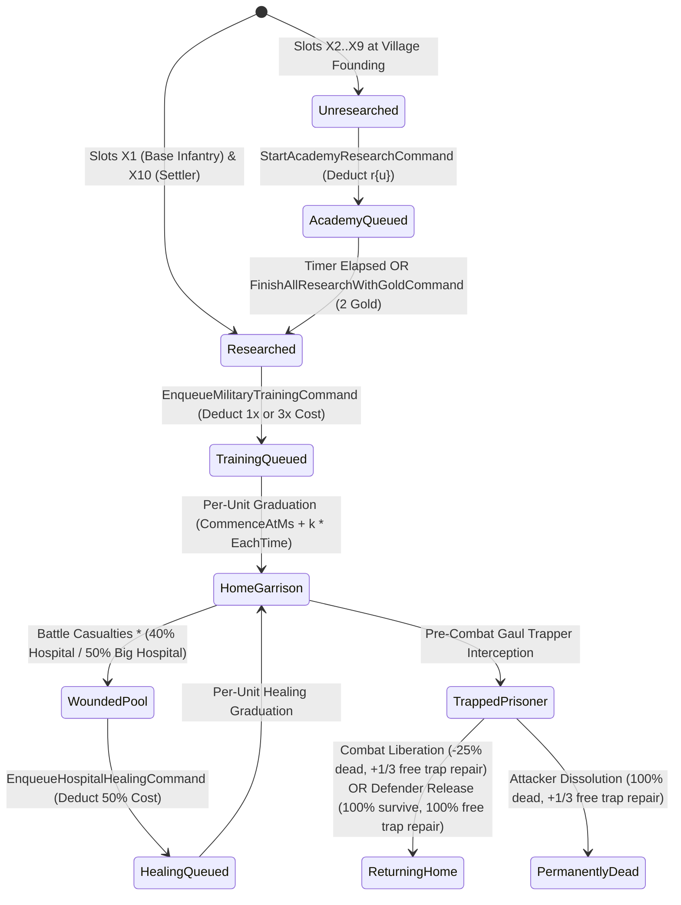

# Phase 1 Data Model: Military Recruitment, Technological Research, Specialty Crafting, and Hospital Casualty Recovery

**Feature Branch**: `003-military-research-hospital`  
**Date**: 2026-11-07  
**Specification**: [spec.md](./spec.md) | **Research**: [research.md](./research.md)

---

## 1. Domain Enumerations & Value Objects (`Terravia.Domain.Villages`)

### 1.1 `TrainingFacilityCategory` (Enum)
Identifies the 9 independent, concurrent FIFO recruitment, crafting, and healing lanes within a village (`FR-001`..`FR-002`):

| Member | Value | Building GID(s) | Cost Multiplier | Description |
| :--- | :---: | :---: | :---: | :--- |
| `Barracks` | `1` | `19` | `1x` | Standard infantry recruitment queue |
| `GreatBarracks` | `2` | `29` | `3x` | Non-capital parallel infantry recruitment queue |
| `Stable` | `3` | `20` | `1x` | Standard cavalry recruitment queue |
| `GreatStable` | `4` | `30` | `3x` | Non-capital parallel cavalry recruitment queue |
| `Workshop` | `5` | `21` | `1x` | Standard siege engine (Ram/Catapult) recruitment queue |
| `GreatWorkshop` | `6` | `49` | `3x` | Non-capital parallel siege engine recruitment queue |
| `ResidencePalace` | `7` | `25, 26, 44` | `1x` | Civic expansion unit (Cultural Leader / Settler) queue |
| `Trapper` | `8` | `36` | `1x` (`0x` auto-repair) | Gaul Trap (`u99`) crafting and free auto-repair queue |
| `Healing` | `9` | `46, 48` | `0.5x` (`ceil(cost*amt/2)`) | Hospital / Big Hospital wounded troop healing queue |

### 1.2 `ResearchCategory` (Enum)
Identifies the 3 technological progression lanes in a village (`FR-008`..`FR-009`):
- `Academy = 1` (`gid 22` — unlocks unit slots `2..9`, max `1` active per village, no Plus waiting loop)
- `Blacksmith = 2` (`gid 12` — upgrades offense `b1..b8` levels `1..20`, `1` active + `1` Plus waiting loop)
- `Armoury = 3` (`gid 13` — upgrades defense `a1..a8` levels `1..20`, `1` active + `1` Plus waiting loop)

### 1.3 `HeroRecruitmentHelmetKind` (Enum)
Represents stationed Hero helmet modifiers (`ItemId 10..15`) affecting infantry or cavalry training (`FR-006`):
- `None = 0` (`0%`)
- `Horseman10 = 10` (`-10%` Cavalry, `ItemId 10`)
- `Cavalry15 = 11` (`-15%` Cavalry, `ItemId 11`)
- `HeavyCavalry20 = 12` (`-20%` Cavalry, `ItemId 12`)
- `Mercenary10 = 13` (`-10%` Infantry, `ItemId 13`)
- `Warrior15 = 14` (`-15%` Infantry, `ItemId 14`)
- `Ruler20 = 15` (`-20%` Infantry, `ItemId 15`)

### 1.4 `HeroBandageTier` (Enum)
Represents equipped Hero T4 Bandage tiers evaluated before Hospital casualty interception (`FR-011`):
- `None = 0` (`0%` revival)
- `SmallBandage25 = 206` (`25%` revival, `ItemId 206`)
- `LargeBandage33 = 207` (`33%` revival, `ItemId 207`)

---

## 2. In-Memory Aggregate State & Queue Models (`Terravia.Domain.Villages`)

### 2.1 `TrainingQueueItem` (`sealed class`)
Represents an active or queued unit recruitment, trap crafting, or Hospital healing batch in `VillageState.TrainingQueues`:

| Property | Type | Constraints / Invariants |
| :--- | :--- | :--- |
| `QueueItemId` | `long` | Monotonically increasing per-village queue identifier |
| `VillageId` | `int` | Owning village ID |
| `FacilityCategory` | `TrainingFacilityCategory` | Lane key (`1..9`) |
| `UnitTypeId` | `int` | `1..90` or `99` (`u99` Gaul Trap) |
| `AmountRemaining` | `int` | `> 0`; decremented as individual units graduate |
| `PopUpkeepPerUnit` | `int` | `>= 0` (`0` for `u99` Traps) |
| `EachTimeSeconds` | `int` | `>= 1` (locked at submission via 4-stage pipeline or Hospital formula) |
| `CommenceAtMs` | `long` | Timestamp (ms) when the current single unit in the batch began training |
| `FinishesAtMs` | `long` | `CommenceAtMs + (long)AmountRemaining * EachTimeSeconds * 1000L` |
| `NextUnitGraduatesAtMs` | `long` | Computed: `CommenceAtMs + EachTimeSeconds * 1000L` |

### 2.2 `ResearchQueueItem` (`sealed class`)
Represents an active Academy discovery or Blacksmith/Armoury upgrade in `VillageState.ResearchQueue`:

| Property | Type | Constraints / Invariants |
| :--- | :--- | :--- |
| `QueueItemId` | `long` | Monotonically increasing identifier |
| `VillageId` | `int` | Owning village ID |
| `Category` | `ResearchCategory` | `Academy`, `Blacksmith`, or `Armoury` |
| `UnitTypeId` | `int` | `1..90` |
| `TribeUnitSlot` | `int` | `1..9` (`2..9` for Academy, `1..8` for Blacksmith/Armoury) |
| `TargetLevel` | `int` | `1` for Academy discovery; `1..20` for Blacksmith/Armoury |
| `IsPlusWaitingLoop` | `bool` | `false` for Academy and 1st Smithy slot; `true` for 2nd Smithy slot |
| `StartedAtMs` | `long` | Timestamp (ms) when research/upgrade starts |
| `FinishesAtMs` | `long` | Timestamp (ms) when research/upgrade completes |

### 2.3 `PrisonerStack` (`sealed class`)
Represents a captured hostile army or partial troop group held in a Gaul village's `Trapper` (`FR-014`..`FR-015`):

| Property | Type | Constraints / Invariants |
| :--- | :--- | :--- |
| `PrisonerStackId` | `long` | Unique stack ID (matches `StarvationCandidateStack.StackOrMovementId`) |
| `CaptorVillageId` | `int` | Gaul (or Archon Capital) village holding the prisoners (`wref`) |
| `OwnerVillageId` | `int` | Home village of the captured troops (`from`, which pays crop upkeep) |
| `OwnerPlayerId` | `int` | Player ID of the captured troops' owner |
| `OwnerAllianceId` | `int` | Alliance ID of the captured troops' owner (`0` if none) |
| `OwnerTribeId` | `int` | Tribe ID (`1..9`) of the captured troops |
| `UnitCountsBySlot` | `int[]` | Length `11` (`indices 1..10` for tribe slots `t1..t10`) |
| `HasCapturedHero` | `bool` | Equivalent to `t11 == 1` |
| `TotalOccupiedTraps` | `int` | Computed: $\sum_{i=1}^{10} \text{UnitCountsBySlot}[i] + (\text{HasCapturedHero} ? 1 : 0)$ |

### 2.4 `VillageState` Extensions (`Terravia.Domain.Villages.VillageState`)
`VillageState` is extended with the following fields to support `FR-001`..`FR-015`:
- **Military &Accelerator Modifiers**:
  - `double TrainerArtifactMultiplier { get; set; } = 1.0;` (`1.0`, `0.75`, or `0.50`)
  - `HeroRecruitmentHelmetKind StationedHeroHelmet { get; set; } = HeroRecruitmentHelmetKind.None;`
  - `int AllianceRecruitmentBonusLevel { get; set; }` (`0..5`)
  - `long AllianceJoinedAtMs { get; set; }`
  - `bool BlockTrainingOnNegativeCrop { get; set; }` (`Default = false` per Clarification Q1)
- **Per-Village Technology & Smithy State**:
  - `bool[] UnlockedUnitSlots { get; } = new bool[11];` (indices `1..10`; `UnlockedUnitSlots[1] = true`, `UnlockedUnitSlots[10] = true` initialized in constructor)
  - `int[] OffenseUpgradeLevels { get; } = new int[9];` (indices `1..8`, values `0..20`)
  - `int[] DefenseUpgradeLevels { get; } = new int[9];` (indices `1..8`, values `0..20`)
- **Hospital & Trapper Pools**:
  - `int[] WoundedUnitsBySlot { get; } = new int[9];` (indices `1..8`, values `>= 0`, `0` crop upkeep)
  - `List<PrisonerStack> HeldPrisoners { get; } = [];`
- **Active Queues**:
  - `List<TrainingQueueItem> TrainingQueues { get; } = [];`
  - `List<ResearchQueueItem> ResearchQueue { get; } = [];`
- **Dispatch Snapshot Support on `StarvationCandidateStack` / `VillageTroopStack`**:
  - `int[] OffenseUpgradeLevels { get; } = new int[9];` (snapshotted from home village at dispatch per Clarification Q3)
  - `int[] DefenseUpgradeLevels { get; } = new int[9];` (snapshotted from home village at dispatch per Clarification Q3)

---

## 3. Persistence Schema & TVP Mapping (`Terravia.Infrastructure.Villages`)

### 3.1 `VillageTrainingQueueItem` (`dbo.VillageTrainingQueues`)
| Column | SQL Type | C# Property | Description |
| :--- | :--- | :--- | :--- |
| `QueueItemId` | `BIGINT PK` | `QueueItemId` | Queue item primary key |
| `VillageId` | `INT INDEX` | `VillageId` | Owning village ID |
| `FacilityCategory` | `TINYINT` | `FacilityCategory` | `TrainingFacilityCategory` (`1..9`) |
| `UnitTypeId` | `INT` | `UnitTypeId` | `1..90` or `99` |
| `AmountRemaining` | `INT` | `AmountRemaining` | Remaining units in batch |
| `PopUpkeepPerUnit` | `INT` | `PopUpkeepPerUnit` | Crop upkeep per graduated unit |
| `EachTimeSeconds` | `INT` | `EachTimeSeconds` | Locked per-unit duration in seconds |
| `CommenceAtMs` | `BIGINT` | `CommenceAtMs` | Start timestamp (ms) of current unit |
| `FinishesAtMs` | `BIGINT` | `FinishesAtMs` | Batch completion timestamp (ms) |

### 3.2 `VillageResearchQueueItem` (`dbo.VillageResearchQueues`)
| Column | SQL Type | C# Property | Description |
| :--- | :--- | :--- | :--- |
| `QueueItemId` | `BIGINT PK` | `QueueItemId` | Research queue primary key |
| `VillageId` | `INT INDEX` | `VillageId` | Owning village ID |
| `Category` | `TINYINT` | `Category` | `1`=Academy, `2`=Blacksmith, `3`=Armoury |
| `UnitTypeId` | `INT` | `UnitTypeId` | `1..90` |
| `TribeUnitSlot` | `TINYINT` | `TribeUnitSlot` | `1..9` |
| `TargetLevel` | `TINYINT` | `TargetLevel` | `1` (Academy) or `1..20` (Smithy) |
| `IsPlusWaitingLoop` | `BIT` | `IsPlusWaitingLoop` | `1` if Plus 2nd Smithy slot |
| `StartedAtMs` | `BIGINT` | `StartedAtMs` | Start timestamp (ms) |
| `FinishesAtMs` | `BIGINT` | `FinishesAtMs` | Completion timestamp (ms) |

### 3.3 `VillageTechnology` (`dbo.VillageTechnologies`)
| Column | SQL Type | C# Property | Description |
| :--- | :--- | :--- | :--- |
| `VillageId` | `INT PK` | `VillageId` | Owning village ID |
| `UnlockedSlotsMask` | `INT` | `UnlockedSlotsMask` | Bitmask for slots `1..10` (`(1 << 1) \| (1 << 10)` default) |
| `OffenseLevels` | `BINARY(8)` / `INT[]` | `OffenseUpgradeLevels` | Levels `0..20` for slots `b1..b8` |
| `DefenseLevels` | `BINARY(8)` / `INT[]` | `DefenseUpgradeLevels` | Levels `0..20` for slots `a1..a8` |
| `WoundedSlots` | `INT[8]` (`w1..w8`) | `WoundedUnitsBySlot` | Hospital wounded counts for slots `1..8` |

---

## 4. State Transitions & Domain Invariants

